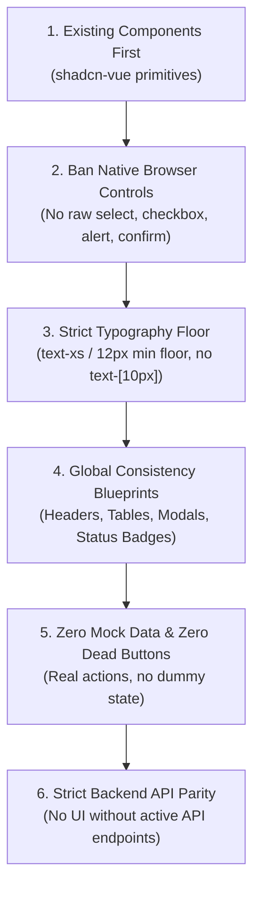

# Frontend Discipline & Strict Component System Specification

> **Mandatory Rule for Coding Agents:** Raiwall's user interface is an enterprise cybersecurity console. High consistency, real backend data integrity, first-class UI component primitives, and accessible typography are non-negotiable. Coding agents must adhere to these 6 cardinal rules with zero exceptions.

---

## The 6 Cardinal Rules



---

## 1. Rule 1: Use Existing Components Over Building New Ones

Always inspect and reuse the established UI primitives in `web/src/components/ui/` before authoring any template markup:

| UI Need | Established Primitive | Location |
| :--- | :--- | :--- |
| **Buttons & Action Triggers** | `Button` | `@/components/ui/button` |
| **Status Badges & Chips** | `Badge` | `@/components/ui/badge` |
| **Data Cards & Panels** | `Card`, `CardHeader`, `CardTitle`, `CardDescription`, `CardContent`, `CardFooter` | `@/components/ui/card` |
| **Dialogs & Modals** | `Dialog`, `DialogTrigger`, `DialogContent`, `DialogHeader`, `DialogTitle`, `DialogDescription`, `DialogFooter` | `@/components/ui/dialog` |
| **Form Inputs** | `Input` | `@/components/ui/input` |
| **Search Bars** | `SearchInput` | `@/components/ui/search-input` |
| **Numeric Controls** | `NumberInput` | `@/components/ui/number-input` |
| **Dropdown Menus & Selects** | `Select`, `SelectTrigger`, `SelectValue`, `SelectContent`, `SelectItem` | `@/components/ui/select` |
| **Toggles & Booleans** | `Switch` | `@/components/ui/switch` |
| **Data Tables** | `Table`, `TableHeader`, `TableBody`, `TableHead`, `TableRow`, `TableCell` | `@/components/ui/table` |
| **Tabs & Segmented Controls** | `Tabs`, `TabsList`, `TabsTrigger`, `TabsContent` | `@/components/ui/tabs` |
| **Tooltips & Hints** | `Tooltip`, `TooltipTrigger`, `TooltipContent`, `TooltipProvider` | `@/components/ui/tooltip` |
| **Date Selection** | `DatePicker` | `@/components/ui/date-picker` |
| **Popovers & Flyouts** | `Popover`, `PopoverTrigger`, `PopoverContent` | `@/components/ui/popover` |

### Missing Primitives Protocol
If a required UI primitive is absent from `web/src/components/ui/` (e.g. `Checkbox`, `AlertDialog`, `DropdownMenu`, `Slider`, `Accordion`):
- ❌ **STRICTLY FORBIDDEN:** Writing ad-hoc custom HTML divs, raw tags, or ad-hoc scoped styling to simulate the primitive.
- ✅ **MANDATORY:** Scaffold or install the official **shadcn-vue** (Radix Vue) primitive into `web/src/components/ui/<component-name>` first, adhering to the project's Tailwind semantic tokens, and then import it cleanly.

---

## 2. Rule 2: Never Use Native Browser Default Components

Native browser controls look jarring, break dark/light theme consistency, ignore keyboard navigation styling, and degrade enterprise feel.

### 2.1 Strictly Banned Native Elements & Methods

| Banned Native Control | Why It Is Prohibited | Mandatory Replacement |
| :--- | :--- | :--- |
| `<select>`, `<option>` | Native OS drop-down cannot be styled, breaks theme tokens, looks amateurish. | `Select`, `SelectTrigger`, `SelectContent`, `SelectItem` from `@/components/ui/select` |
| `<input type="checkbox">` | OS-rendered checkbox, unstyled accent colors, inconsistent cross-browser sizing. | `Switch` from `@/components/ui/switch` or shadcn-vue `Checkbox` primitive. |
| `<input type="radio">` | Unstyled browser radio circle. | shadcn-vue `RadioGroup` primitive or `Tabs` / `Switch`. |
| `<button>` (raw tag) | Misses standard focus rings, typography scales, hover transitions, and semantic variants. | `Button` from `@/components/ui/button` |
| `<input type="search">` | Native clear "x" icon clashes with dark mode. | `SearchInput` from `@/components/ui/search-input` |
| `<input type="date">` | Clunky native browser date picker with inconsistent OS UI. | `DatePicker` from `@/components/ui/date-picker` |
| `window.confirm()` | Blocks the UI thread, impossible to theme, lacks context and destructive styling. | `Dialog` or `AlertDialog` with explicit action verbs (e.g., "Delete Site", "Revoke Key"). |
| `window.alert()` | Obtrusive OS dialog, blocks execution, unthemed. | Inline error alerts or toast notifications with active-voice feedback. |
| `window.prompt()` | Native text prompt cannot be styled or validated. | Form dialog with standard `Input` and validation. |
| `title="..."` attribute | Delayed native browser tooltip, unstyled OS yellow/gray popup. | `Tooltip`, `TooltipContent` from `@/components/ui/tooltip` |
| Unstyled browser scrollbars | Raw OS scrollbars clash with dark backgrounds. | Tailwind custom scrollbar utilities (`scrollbar-thin scrollbar-thumb-border scrollbar-track-transparent`). |

---

## 3. Rule 3: Typography & Strict Minimum Font Size Floor

Typography establishes hierarchy, technical authority, and visual ergonomics. Unreadable micro-fonts degrade operator speed during incident response.

### 3.1 Strict Font Size Floor: `text-xs` (12px / 0.75rem)
- ❌ **STRICTLY BANNED:** Any sub-12px micro-text: `text-[10px]`, `text-[11px]`, `text-[9px]`, `text-[8px]`, or inline `font-size: <12px`.
- ✅ **ABSOLUTE MINIMUM:** `text-xs` (12px) is the hard floor across the entire codebase. No exceptions for badges, timestamps, table cells, or metadata labels.

### 3.2 Canonical Typography Scale

| Role | Tailwind Class | Minimum Size | Usage & Application |
| :--- | :--- | :--- | :--- |
| **Page Title** | `text-xl font-bold tracking-tight text-foreground` | 20px (`1.25rem`) | Main view header (e.g., "Sites & Upstreams", "Access Control Lists"). |
| **Section / Card Header** | `text-base font-semibold text-foreground` | 16px (`1.0rem`) | Card headers, modal titles, drawer headings. |
| **Primary Body & Form Controls** | `text-sm font-normal text-foreground` | 14px (`0.875rem`) | Standard input values, table primary text, dialog body copy, button labels. |
| **Secondary Descriptions** | `text-sm text-muted-foreground` | 14px (`0.875rem`) | Header subtext, field descriptions, helper text. |
| **Eyebrows & Field Labels** | `text-xs font-semibold uppercase tracking-wider text-muted-foreground` | 12px (`0.75rem`) | Form field labels, category tags, section eyebrows. |
| **Status Badges & Chips** | `text-xs font-medium` | 12px (`0.75rem`) | System status (`ONLINE`, `BLOCKED`, `RATE_LIMITED`). |
| **Technical Telemetry & Code** | `text-xs font-mono tabular-nums` | 12px (`0.75rem`) | IPv4/IPv6, CIDR blocks, port numbers, JA4 hashes, latencies, HTTP status codes. |

---

## 4. Rule 4: Systemic Consistency Across the Whole Web App

Every screen in Raiwall must feel like it was crafted by the same senior engineer using a unified architectural design language.

### 4.1 Page Header Blueprint
Every top-level view must follow identical header anatomy:
```vue
<div class="flex flex-col sm:flex-row sm:items-center sm:justify-between gap-4 pb-6 border-b border-border">
  <div>
    <h1 class="text-xl font-bold tracking-tight text-foreground">{{ pageTitle }}</h1>
    <p class="text-sm text-muted-foreground mt-1">{{ pageDescription }}</p>
  </div>
  <div class="flex items-center gap-2">
    <!-- Primary and Secondary Actions using standard Button primitives -->
    <Button variant="outline" size="sm" @click="handleSecondaryAction">
      <RefreshCw class="w-4 h-4 mr-2" />
      Refresh
    </Button>
    <Button size="sm" @click="handlePrimaryAction">
      <Plus class="w-4 h-4 mr-2" />
      Add Site
    </Button>
  </div>
</div>
```

### 4.2 Data Table Layout Blueprint
All data collections (Sites, Rules, Exceptions, Bans, Certificates) must follow the standardized table pattern:
1. **Top Toolbar:** Search bar on left (`SearchInput`), filters in middle (`Select`), batch actions on right (`Button`).
2. **Table Header:** `TableHeader` with uppercase muted typography (`text-xs font-semibold uppercase tracking-wider text-muted-foreground`).
3. **Table Body:** Compact rows (`py-2.5`), monospaced technical tokens (`font-mono tabular-nums text-xs`), centered status badges, right-aligned action buttons.
4. **Table Footer / Pagination:** Total count indicator ("Showing 1–25 of 142 items") and pagination controls.

### 4.3 Modal & Dialog Structure Blueprint
Modals must never vary in spatial layout:
- **Header:** `DialogTitle` (clear, active-voice noun/verb) + `DialogDescription` (single explanatory sentence).
- **Body:** Standard form layout with `space-y-4` or `grid grid-cols-2 gap-4`.
- **Footer:** `DialogFooter` with Cancel button on left (`variant="outline"`) and deterministic confirmation button on right (`variant="default"` or `variant="destructive"`).

### 4.4 Unified Semantic Status Badges
Status indicators must use the identical semantic mapping everywhere:

| Semantic State | Tailwind Class Combination | Meaning & When to Use |
| :--- | :--- | :--- |
| **Active / Clean / Healthy** | `bg-success/10 text-success border border-success/30` | Healthy upstream, verified clean traffic, active rule. |
| **Threat / Blocked / Error** | `bg-threat/10 text-threat border border-threat/30` | Blocked exploit, active ban, failed health check. |
| **Warning / Challenged** | `bg-warning/10 text-warning border border-warning/30` | PoW bot challenge, rate-limited waiting queue, expiring cert. |
| **Info / Audit Mode** | `bg-info/10 text-info border border-info/30` | Audit mode only, auto-discovered route, staged change. |
| **Inactive / Disabled** | `bg-muted text-muted-foreground border border-border` | Disabled rule, offline site, revoked key. |

---

## 5. Rule 5: Zero Mock Data & Zero Dead Buttons

Raiwall is production infrastructure software. The UI must represent true system state.

### 5.1 Absolute Ban on Mockup Data in Production Code
- ❌ **STRICTLY BANNED:** Hardcoding dummy items, fake arrays, or synthetic objects in production components, views, or Pinia stores (`const mockRules = [...]`, `const dummySites = [...]`).
- ❌ **STRICTLY BANNED:** Fabricating fake statistics or simulated attack counters to make empty states look busy.
- ✅ **MANDATORY:** All displayed datasets must originate from real Pinia stores or typed API client calls (`@/api/*`).
- ℹ️ **Test Scope Exception:** Mock data is permitted **only** inside Vitest test files (`*.spec.ts`, `__tests__/*`).

### 5.2 Absolute Ban on Dead Buttons
Every clickable element must perform a concrete, deterministic action:
- ❌ **STRICTLY BANNED:** Buttons with empty or no-op handlers: `@click=""`, `@click="() => {}"`, `@click="void 0"`.
- ❌ **STRICTLY BANNED:** Buttons with logging placeholders: `@click="console.log('clicked')"` or `@click="alert('Coming soon')'`.
- ❌ **STRICTLY BANNED:** Decorative button elements that appear interactive but carry no event listener.
- ✅ **MANDATORY:**
  - Every button must trigger an API mutation, a navigation transition, or open a functional dialog/drawer.
  - While an asynchronous action is executing, the button must enter the loading state (`disabled`, `opacity-50`, with a spinner icon).
  - If an action cannot currently be taken because preconditions are unmet (e.g. no rows selected in a batch table), the button must be explicitly `disabled` with a `Tooltip` explaining the requirement.

---

## 6. Rule 6: Absolute Backend API Parity (No UI Without API)

Displaying frontend controls or data visualization without supporting backend endpoints is a **critical red flag**.

### 6.1 The Parity Principle
- ❌ **STRICTLY BANNED:** Designing or rendering frontend views, cards, tables, or buttons for features that have no corresponding backend endpoints in the Go/Huma data plane.
- ❌ **STRICTLY BANNED:** Inventing client-side "shims" or fake local storage stores to simulate backend persistence when the Go API does not exist.
- ✅ **MANDATORY:**
  1. The Go backend route (Huma OpenAPI 3.1) must exist and be registered in `internal/adapters/inbound/http/`.
  2. The typed client in `web/src/api/` must export the typed function matching the endpoint.
  3. The Pinia store must manage the asynchronous lifecycle (loading, error, data).
  4. Only then may the UI view or component render the feature.

---

## 7. Pre-Commit Verification & Audit Checklist

Before submitting or merging any frontend code changes, agents must verify every item:

- [ ] **1. Component Check:** Are all buttons, inputs, selects, switches, tables, and dialogs imported from `@/components/ui/`?
- [ ] **2. No Native Controls:** Is the code 100% free of `<select>`, `type="checkbox"`, `type="radio"`, `window.confirm()`, `window.alert()`, and native `title="..."` tooltips?
- [ ] **3. Typography Floor:** Is there zero sub-12px micro-text (no `text-[10px]`, `text-[11px]`, etc.)? Are all body/input controls at least `text-sm` (14px)?
- [ ] **4. Consistency Blueprint:** Does the view strictly adhere to the standard header, table, and dialog blueprints?
- [ ] **5. Zero Mock Data:** Is all data sourced from real API stores? Are test fixtures isolated to `*.spec.ts`?
- [ ] **6. No Dead Buttons:** Does every interactive control have a functional `@click` handler with in-flight loading protection?
- [ ] **7. Backend Parity:** Does every rendered control and metric map directly to an existing, verified Huma API endpoint?
- [ ] **8. Automated Discipline Scanner:** Did `npm run lint:discipline` pass with zero violations?
