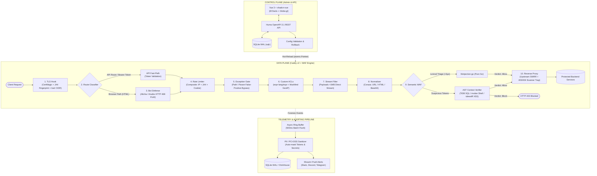

# AGENTS.md — Raiwall

> **Raiwall** is an open-source, enterprise-grade Web Application Firewall (WAF) and reverse proxy gateway. The data plane is built as a native Caddy v2 module in Go; the control plane ships a Vue 3 + TypeScript admin dashboard embedded in the same single binary via `go:embed`.

---

## Table of Contents

- [Project Overview](#project-overview)
- [Architecture](#architecture)
- [Feature Domains](#feature-domains)
- [Tech Stack](#tech-stack)
- [Project Structure](#project-structure)
- [Key Libraries & Dependencies](#key-libraries--dependencies)
- [Development Guidelines](#development-guidelines)
- [Testing Strategy](#testing-strategy)
- [Production Constraints & Risk Mitigations](#production-constraints--risk-mitigations)
- [Engineering Roadmap](#engineering-roadmap)
- [Knowledge Graph (graphify)](#knowledge-graph-graphify)
- [Commit Conventions](#commit-conventions)

---

## Project Overview

Raiwall is a self-hosted, enterprise-grade WAF that combines:

- **High-throughput reverse proxying** (HTTP/1.1, HTTP/2, HTTP/3/QUIC, WebSockets, gRPC) via Caddy v2.
- **Semantic threat detection** using a three-stage funnel: recursive normalization → pure-Go `libinjection-go` lexical triage (< 2 µs) → bounded AST context verification (SQL, Shell, XSS).
- **Active bot defense** with JA4 TLS fingerprinting, intelligent API/browser route classification, and stateless Proof-of-Work challenges.
- **Three-tiered composite rate limiting** with anti-CGNAT protection.
- **Granular access control** with parameter-level false-positive exceptions, compiled bytecode ACL rules, and zero-code pre-application auth.
- **Real-time observability** with async forensic logging, 3D attack globe, and multi-channel alerting.

The entire stack ships as a **single Go binary** with the Vue admin UI embedded via `go:embed`.

---

## Architecture



---

## Feature Domains

| # | Domain | Summary |
|---|--------|---------|
| 1 | **Reverse Proxy & Gateway** | Caddy v2 data plane: multi-protocol proxying, automated SSL/ACME, `atomic.Pointer[ConfigSnapshot]` hot-reload, `sync.Pool` buffer pooling, weighted round-robin load balancing, active health checks. |
| 2 | **Semantic Threat Detection** | Three-stage funnel: recursive normalization (Coraza) → pure-Go `libinjection-go` lexical triage (< 2 µs) → bounded AST verification (SQL via TiDB parser, Shell via `mvdan/sh`, XSS via `tdewolff/parse`). Hard 32 KB cap and 5 ms timeout per parameter. |
| 3 | **Bot Mitigation & Active Defense** | JA4/JA4H TLS fingerprinting, HTTP/2 frame fingerprinting, intelligent API vs. browser route classification, stateless SHA-256 Proof-of-Work (HTTP 468), HMAC clearance cookies, SPA hydration protection. |
| 4 | **DDoS & Rate Limiting** | Three-tiered rate limiting: Tier 1 (access velocity → PoW), Tier 2 (attack frequency → auto-ban), Tier 3 (scanner trap on upstream 403/404 → ban). Composite keys (IP + JA4 + Cookie) for CGNAT safety. Ristretto (single-node) / Redis (cluster). |
| 5 | **Access Control & Identity** | Parameter-level false-positive exception engine, compiled bytecode ACLs (`expr-lang/expr`, < 15 ns), balanced routing table CIDR matching (`gaissmai/bart`, ~15 ns for 500K+ IPs), MaxMind GeoIP, OIDC/SSO zero-code pre-auth. |
| 6 | **Observability & Forensics** | Async ring buffer (500 ms flush), dual storage (SQLite WAL default / ClickHouse enterprise), automated PII/PCI-DSS sanitization, live SSE/WebSocket inspector, 3D attack globe (Globe.gl), ECharts dashboards, multi-channel alerts (Shoutrrr). |
| 7 | **Control Plane & Ecosystem** | Unified single-binary execution, atomic config rollback, Huma OpenAPI 3.1 REST API, Envoy `ext_proc/v3` gRPC sidecar mode, Redis Pub/Sub cluster sync. |

---

## Tech Stack

### Backend (Go)

| Concern | Technology |
|---------|-----------|
| Language | **Go 1.27+** |
| Reverse Proxy Core | **Caddy v2** (`caddyserver/caddy/v2` v2.8.4) |
| SSL/TLS | **CertMagic** (`caddyserver/certmagic`) |
| REST API | **Huma v2** (`danielgtaylor/huma/v2`) — auto-generates OpenAPI 3.1 |
| Database | **SQLite** via `modernc.org/sqlite` (pure Go, WAL mode) |
| SQL Layer | **sqlc** — compiles SQL queries to type-safe Go code |
| Structured Logging | **Zap** (`go.uber.org/zap`) — consistent with Caddy internals |
| Metrics | **Prometheus** (`prometheus/client_golang`) |
| Alerting | **Shoutrrr** (`containrrr/shoutrrr`) |
| WAF Lexer | **libinjection-go** (`corazawaf/libinjection-go`, Pure Go / CGO-free) |
| WAF Normalization | **Coraza** (`corazawaf/coraza`) |
| WAF AST (SQL) | **TiDB Parser** (`pingcap/tidb/pkg/parser`) or `xwb1989/sqlparser` |
| WAF AST (Shell) | **mvdan/sh** (`mvdan/sh/v3/syntax`) |
| WAF AST (HTML/JS) | **tdewolff/parse** (`tdewolff/parse/v2`) |
| TLS Fingerprinting | **JA4+** (`exaring/ja4plus`) |
| Rate Limiting (local) | **Ristretto** (`dgraph-io/ristretto`) |
| Rate Limiting (distributed) | **ulule/limiter** over Redis/Dragonfly |
| ACL Engine | **expr** (`expr-lang/expr`) |
| CIDR Matching | **BART** (`gaissmai/bart`) |
| GeoIP | **MaxMind** (`oschwald/maxminddb-golang`) |
| PoW Challenges | **Altcha** (`altcha-org/altcha`) or **Anubis** (`TecharoHQ/anubis`) |
| Sidecar gRPC | **grpc-go** (`envoy/service/ext_proc/v3`) |
| Testing | **stdlib `testing`** + **testify** (`stretchr/testify`) |
| Linting | **`go vet`** + **`golangci-lint`** |

### Frontend (Vue)

| Concern | Technology |
|---------|-----------|
| Framework | **Vue 3** (latest) + **TypeScript** |
| Build Tool | **Vite** |
| UI Components | **shadcn-vue** (Radix primitives + Tailwind CSS) |
| State Management | **Pinia** |
| Routing | **Vue Router 4** |
| Charts | **Apache ECharts** |
| 3D Attack Globe | **Globe.gl** (Three.js) |
| Unit Testing | **Vitest** + **Vue Test Utils** |
| E2E Testing | **Playwright** |
| Linting | **ESLint** + **Prettier** |

### Packaging

- **Monorepo**: Frontend lives at `web/` in the same repository.
- **Embedding**: Production frontend build (`web/dist/`) is embedded into the Go binary via `go:embed`.
- **Single Binary**: `bin/raiwall` ships everything — reverse proxy, WAF engine, REST API, and admin dashboard.

---

## Project Structure

```
raiwall/
├── cmd/
│   └── raiwall/              # Go entrypoint (embeds Caddy CLI runtime)
│       ├── main.go
│       └── version.go
├── pkg/
│   ├── config/               # Thread-safe atomic config snapshot & run modes
│   ├── engine/               # WAF engine interface & implementations
│   └── proxy/                # Caddy middleware, interceptors, client IP, upstream pool
├── web/                      # Vue 3 + TypeScript admin dashboard (Vite)
│   ├── src/
│   │   ├── components/       # shadcn-vue UI components
│   │   ├── composables/      # Vue composables (reusable logic)
│   │   ├── pages/            # Route pages
│   │   ├── stores/           # Pinia stores
│   │   ├── types/            # TypeScript type definitions
│   │   └── utils/            # Shared utilities
│   ├── public/
│   ├── index.html
│   ├── vite.config.ts
│   ├── tsconfig.json
│   └── package.json
├── tests/
│   └── e2e/                  # Go integration tests (build tag: integration)
├── examples/
│   └── Caddyfile             # Example Caddyfile with weighted round-robin
├── tasks/
│   ├── plan.md               # Implementation plan & architecture decisions
│   └── todo.md               # Task breakdown with acceptance criteria
├── Dockerfile                # Multi-stage: golang:1.27-alpine → alpine:latest (<50 MB)
├── Makefile                  # build, test, test-integration, lint, run targets
├── go.mod
├── go.sum
└── AGENTS.md                 # ← You are here
```

---

## Key Libraries & Dependencies

### Go (Data Plane & Control Plane)

| Library | Role | Why This One |
|---------|------|--------------|
| `caddyserver/caddy/v2` | Reverse proxy, TLS, HTTP/2/3 | Battle-tested, extensible module system, production-grade |
| `caddyserver/certmagic` | Automated ACME/SSL lifecycle | Integrated with Caddy, handles Let's Encrypt + ZeroSSL |
| `danielgtaylor/huma/v2` | REST API framework | Auto-generates OpenAPI 3.1, type-safe, lightweight |
| `modernc.org/sqlite` | Embedded database | Pure Go (no CGO needed for DB), WAL mode, zero-config |
| `sqlc` (build tool) | SQL → type-safe Go code | No ORM overhead, SQL stays readable, compile-time safety |
| `go.uber.org/zap` | Structured logging | Already in Caddy's dependency tree, high-performance |
| `corazawaf/coraza` | Input normalization | ModSecurity-compatible transformations |
| `corazawaf/libinjection-go` | Fast SQLi/XSS lexical scan | Pure Go port, zero CGO, < 2 µs evaluation |
| `expr-lang/expr` | Compiled boolean ACL rules | Bytecode evaluation in < 15 ns |
| `gaissmai/bart` | CIDR routing table | ~15 ns lookups across 500K+ IP entries |
| `stretchr/testify` | Test assertions | Widely used, `require` + `assert` ergonomics |

### Vue (Admin Dashboard)

| Library | Role | Why This One |
|---------|------|--------------|
| Vue 3 + TypeScript | UI framework | Composition API, TypeScript-first, reactive |
| Vite | Build tool | Fast HMR, native ESM, optimized production builds |
| shadcn-vue | UI primitives | Unstyled Radix components + Tailwind, full control |
| Pinia | State management | Official Vue 3 store, lightweight, TypeScript-native |
| Vue Router 4 | Client-side routing | Official, nested routes, navigation guards |
| Apache ECharts | Charts & dashboards | Feature-rich, performant, enterprise-grade |
| Globe.gl | 3D attack visualization | Three.js-based WebGL globe for GeoIP arc rendering |
| Vitest | Unit testing | Vite-native, fast, compatible with Vue Test Utils |
| Playwright | E2E testing | Cross-browser, reliable, modern API |

---

## Development Guidelines

### Go Backend

1. **Idiomatic Go**: Write simple, readable code. Avoid unnecessary abstractions. Prefer stdlib solutions when they exist.
2. **Error Handling**: Always handle errors explicitly. Use `fmt.Errorf("context: %w", err)` for wrapping. Never ignore errors silently.
3. **Interfaces**: Define interfaces at the consumer site, not the provider. Keep interfaces small (1–3 methods).
4. **Concurrency**: Use `sync.Pool` for hot-path buffer reuse. Use `atomic.Pointer` for lock-free config reads. Use channels for coordination, mutexes for state protection.
5. **Package Layout**: Follow the existing `pkg/` structure. Each package should have a single clear responsibility.
6. **Naming**: Use short, clear names. Exported symbols get doc comments. Package names are singular nouns.
7. **No Over-Engineering**: Do not add abstractions, patterns, or layers unless they solve a concrete, immediate problem.

### Vue Frontend

1. **Composition API**: Always use `<script setup lang="ts">`. No Options API.
2. **TypeScript**: Strict mode enabled. All props, emits, and store state must be typed. No `any` unless absolutely necessary.
3. **Components**: Use shadcn-vue primitives. Colocate component styles with Tailwind utility classes. Keep components small and focused.
4. **State**: Use Pinia stores for shared state. Use composables (`use*`) for reusable reactive logic. Keep component-local state in `ref`/`reactive`.
5. **API Layer**: Centralize API calls in a typed client generated from the OpenAPI 3.1 spec (or a thin wrapper around `fetch`).
6. **Naming**: PascalCase for components, camelCase for composables and utilities, kebab-case for file names.
7. **UI Color Consistency & Semantic Tokens**: Always use semantic Tailwind design tokens mapped to CSS custom properties (`bg-background`, `bg-card`, `bg-muted`, `border-border`, `text-foreground`, `text-muted-foreground`, `text-primary`, `text-threat`, `text-success`, `text-warning`, `text-info`). Arbitrary hex classes (e.g. `bg-[#181b20]`, `border-[#2d3440]`, `text-[#EF4444]`) are strictly banned. Components must support dual themes (Light & Dark) via semantic tokens. Refer to `.agents/rules/ui-consistency.md` for full token specification and migration cheat-sheet.
8. **Anti-AI Slop & Enterprise Ergonomics**: Strictly avoid generic, decorative, or bloated 'AI slop' interfaces. Prioritize high information density (compact tables with monospaced tabular figures over decorative card grids), strict color restraint (90%+ neutral grayscale, no rainbow badges, no multi-colored icon chips, no colored card borders), solid surfaces (no purple/cyan neon gradients, no glow shadows, no glassmorphism blur), mandatory 6-state coverage (loading skeletons, actionable empty states, error with retry, string truncation safety, disabled/pending states, keyboard focus), snappy transitions (≤ 150ms), and direct technical copywriting with zero marketing fluff. Refer to `.agents/rules/anti-ui-slop.md` for full directives and the pre-merge finish gate checklist.

### General

- **No dead code**: Remove unused imports, variables, and functions.
- **No magic numbers**: Extract constants with descriptive names.
- **Comments**: Explain *why*, not *what*. Code should be self-documenting for the *what*.

---

## Testing Strategy

### Go

| Level | Tool | Command | Build Tag |
|-------|------|---------|-----------|
| Unit tests | `testing` + `testify` | `go test -v -race ./pkg/...` | — |
| Integration tests | `testing` + `testify` | `go test -v -race -tags=integration ./tests/e2e/...` | `integration` |
| All tests | — | `make test-all` | — |
| Lint | `go vet` + `golangci-lint` | `make lint` | — |

- **Table-driven tests**: Use subtests (`t.Run`) with descriptive names.
- **Race detector**: Always run with `-race` in CI.
- **Test files**: Colocate `*_test.go` next to the code they test.

### Vue

| Level | Tool | Command |
|-------|------|---------|
| Unit / Component | Vitest + Vue Test Utils | `npm run test:unit` |
| E2E | Playwright | `npm run test:e2e` |
| Lint | ESLint + Prettier | `npm run lint` |

---

## Production Constraints & Risk Mitigations

These are **hard constraints** that must be respected in every implementation:

| Risk | Severity | Constraint | Mitigation |
|------|----------|-----------|------------|
| **AST ReDoS / CPU Exhaustion** | High | Attacker crafts nested payloads causing CPU lockup | Hard 32 KB per-parameter cap + 5 ms parser timeout. Fallback to audit logging on timeout. |
| **OOM on Large Uploads** | High | 100 MB+ file uploads buffered in RAM | Stream payloads > 1 MB directly to backend. Only inspect multipart form fields and text metadata. |
| **Mobile / B2B API Breakage** | High | Non-browser clients crash on interactive PoW challenges | Route classifier bypasses bot challenges for `Authorization: Bearer`, `/api/*`, and `Accept: application/json`. |
| **False-Positive Backlash** | Critical | Valid transactions blocked → operators disable WAF | Ship Rule Exception Engine early. Support parameter-level bypasses (Host + Path + Method + Param Name + Location). |
| **CGNAT Collateral Damage** | Medium | Shared IP banned due to single bad client | Use composite rate limiting keys: `ClientIP + JA4 Hash + SessionCookie` for scanner trap bans. |
| **SPA Client Hydration Errors** | Medium | DOM rewriting breaks React/Vue/Next.js hydration | Never apply runtime DOM mutation on SPA routes. Rely on JA4 fingerprinting and PoW instead. |
| **Go GC Latency** | High | GC pauses under > 50K QPS | Use `sync.Pool` byte-buffer pooling. Minimize allocations on the hot path. |
| **Caddy API Breaking Changes** | Medium | Caddy module API changes across minor versions | Pin exact Caddy v2 minor version in `go.mod` (currently v2.8.4). |

---

## Engineering Roadmap

| Milestone | Scope & Deliverables | Timeline | Status |
|-----------|---------------------|----------|--------|
| **1: Core Proxy & Control Plane** | Caddy Proxy + Auto-SSL + Normalization + `libinjection-go` • Minimal Control Plane API (`huma`) + Web UI Log Viewer + Rule Exception Engine | Weeks 1–8 | 🟢 Completed |
| **2: Stateful Defense & AST Verification** | 3-Tier Composite Rate Limiting + Fast CIDR (`bart`) + MaxMind GeoIP + AST Verification (32KB/5ms cap) + ClickHouse batch logging + PII Sanitizer | Weeks 9–16 | 🟢 Completed |
| **3: Active Defense & Sidecar Mode** | JA4 Fingerprinting + HTTP 468 PoW (`altcha`/`anubis` with API bypass) + Envoy/Nginx `ext_proc` sidecar connector + Web UI charts & alerts | Weeks 17–24 | 🟢 Completed |

---

## Knowledge Graph (graphify)

This project maintains a navigable knowledge graph in `graphify-out/` detailing architectural components, god nodes, cross-package call graphs, and community clusters.

### Mandatory Rules for AI Agents

1. **Orientation First**:
   - For codebase or architecture questions, when `graphify-out/graph.json` exists, query the graph first instead of scanning files or running wide grep:
     - `graphify query "<question>"` — extract scoped subgraphs and dependency paths.
     - `graphify path "<A>" "<B>"` — trace shortest dependency and call paths between two symbols or packages.
     - `graphify explain "<concept>"` — inspect all incoming/outgoing connections, callers, and rationale for a node.
2. **Visualizer & Reports**:
   - `graphify-out/graph.html` — interactive knowledge graph (open in browser, no server needed).
   - `graphify-out/GRAPH_REPORT.md` — comprehensive audit report (god nodes, community hubs, and cohesion scores).
3. **Graph Synchronization**:
   - After modifying or introducing Go source files, run `graphify update .` to keep AST extraction, edges, and communities up to date without incurring LLM token costs.
   - Git post-commit hooks are installed to automatically trigger incremental AST re-indexing upon commits.

---

## Commit Conventions
Always commit your work before starting a new task. If a task is not completed, you can make multiple commits until the task is completed. Each commit must be self-contained and should not be dependent on other commits. Always make sure that your last commit is a working commit that can be deployed to production.

Use [Conventional Commits](https://www.conventionalcommits.org/) with scope prefixes:

```
<type>(<scope>): <description>

[optional body]

[optional footer(s)]
```

### Types

| Type | When to Use |
|------|-------------|
| `feat` | New feature or capability |
| `fix` | Bug fix |
| `refactor` | Code change that neither fixes a bug nor adds a feature |
| `test` | Adding or updating tests |
| `docs` | Documentation only |
| `chore` | Build, CI, tooling, or dependency changes |
| `perf` | Performance improvement |

### Scopes

| Scope | Area |
|-------|------|
| `gateway` | Reverse proxy, Caddy middleware, upstream routing |
| `waf` | Threat detection engine, normalization, AST |
| `bot` | Bot mitigation, JA4, PoW challenges |
| `rate` | Rate limiting, DDoS defense |
| `acl` | Access control, exceptions, CIDR, GeoIP |
| `obs` | Observability, logging, alerting |
| `api` | Control Plane REST API |
| `web` | Vue admin dashboard |
| `config` | Configuration system |
| `docker` | Container and deployment |

### Examples

```
feat(gateway): add weighted round-robin upstream load balancing
fix(waf): handle chunked transfer encoding in body inspection
feat(web): add real-time attack log viewer with SSE
chore(docker): optimize multi-stage build to <50MB
test(gateway): add IPv6 client IP extraction edge cases
```
