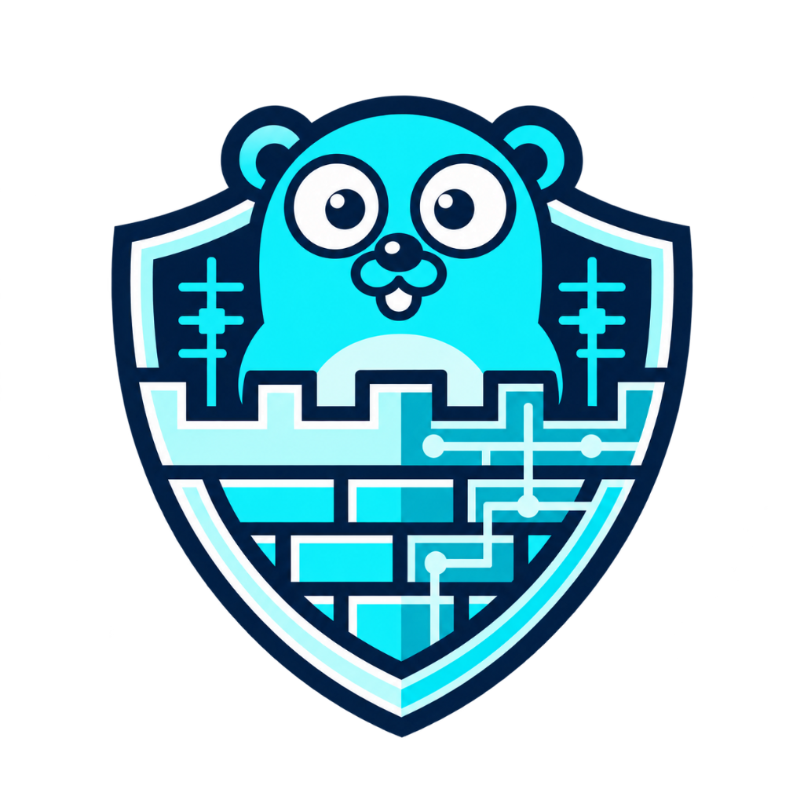
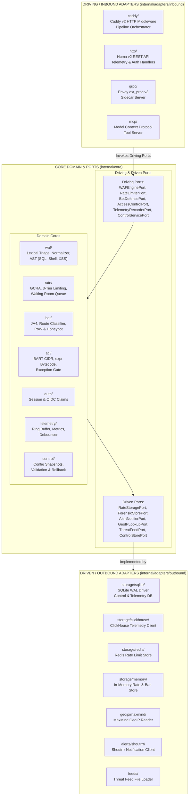
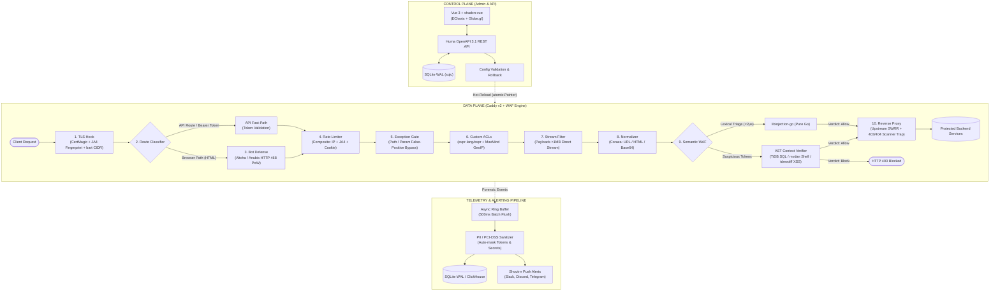

<p align="center">
  
</p>

<h1 align="center">Raiwall</h1>

<p align="center">
  <strong>Enterprise-Grade Web Application Firewall (WAF) & High-Performance Reverse Proxy Gateway</strong>
</p>

<p align="center">
  <a href="https://golang.org"></a>
  <a href="https://caddyserver.com"></a>
  <a href="https://vuejs.org"></a>
  <a href="https://www.typescriptlang.org"></a>
  <a href="#testing"></a>
  <a href="#production-safeguards"></a>
</p>

<p align="center">
  <a href="#overview">Overview</a> •
  <a href="#key-features">Key Features</a> •
  <a href="#architecture">Architecture</a> •
  <a href="#project-structure">Project Structure</a> •
  <a href="#quick-start">Quick Start</a> •
  <a href="#configuration">Configuration</a> •
  <a href="#roadmap">Roadmap</a> •
  <a href="#development">Development</a>
</p>

---

## Overview

**Raiwall** is an open-source, SafeLine-class Web Application Firewall and reverse proxy gateway designed for modern web applications, APIs, and microservices. 

Built natively as a **Caddy v2** module, Raiwall combines extreme proxy throughput with multi-stage semantic threat inspection, stateless bot challenges, anti-CGNAT rate limiting, and real-time forensic visualization — all delivered in a **single, dependency-free binary** embedding a Vue 3 + TypeScript admin dashboard via `go:embed`.

---

## Key Features

### 🛡️ 1. High-Throughput Reverse Proxy & Gateway (Data Plane)
- **Multi-Protocol Gateway:** Native termination and reverse proxying for HTTP/1.1, HTTP/2, HTTP/3 (QUIC), WebSockets, and gRPC.
- **Automated SSL/TLS Lifecycle:** ACME automation via CertMagic (Let's Encrypt / ZeroSSL), custom cert uploads, dynamic SNI, and OCSP stapling.
- **Zero-Downtime Hot Swaps:** `atomic.Pointer[ConfigSnapshot]` applies per-site protection states (**Defense**, **Audit**, **Offline**) in nanoseconds without restarting or dropping long-lived connections.
- **Upstream Resilience:** Smooth Weighted Round-Robin (SWRR) load balancing with background active health probes and automatic failover.
- **Accurate Client Attribution:** Extracts real client IPs through `CF-Connecting-IP`, `X-Real-IP`, `X-Forwarded-For`, and HAProxy `PROXY` protocol v1/v2.

### 🧠 2. Semantic Threat Detection Engine (Core WAF)
- **Three-Stage Funnel:**
  1. *Recursive Normalization:* Multi-pass decoding of URL, HTML entities, Base64, and Unicode escapes with SQL/script comment stripping.
  2. *Pure-Go Lexical Triage:* Ultra-fast token analysis using pure-Go `libinjection-go` ($<2\text{ µs}$) for immediate SQLi/XSS triage with zero CGO overhead.
  3. *Bounded AST Context Verification:* Synthesizes grammar trees to detect execution breakouts (SQL via TiDB parser, Bash via `mvdan/sh`, DOM/JS via `tdewolff/parse`).
- **CPU Starvation Defenses:** Hard 32 KB per-parameter caps and strict 5 ms parser timeouts maintain $p99 < 15\text{ ms}$ under heavy load.

### 🤖 3. Bot Mitigation & Dynamic Active Defense
- **Passive Fingerprinting:** Extracts TLS JA4/JA4H hashes and inspects HTTP/2 settings frames to flag headless CLI scrapers (`curl`, `python-requests`, `sqlmap`).
- **Intelligent Route Separation:** API endpoints (`/api/*`, `Authorization: Bearer`, JSON requests) are never subjected to browser challenges, safeguarding native apps and webhooks.
- **Stateless Proof-of-Work (PoW):** Employs WebCrypto SHA-256 challenges returning signed HMAC clearance cookies (`altcha`/`anubis`).
- **SPA Hydration Safe:** Avoids runtime DOM rewriting on modern SPA frameworks (Vue, React, Next.js).

### ⚡ 4. DDoS & Three-Tiered Rate Limiting
- **Tier 1 (Access Velocity):** Traffic surge mitigation at the ingress pipeline; prompts PoW challenges instead of blunt connection drops.
- **Tier 2 (Attack Frequency):** Increments on blocked exploits and automatically bans persistent threat actors.
- **Tier 3 (Scanner Trap):** Hooks into reverse proxy responses; catches upstream 403/404 scans to auto-ban directory brute-forcers (`ffuf`, `gobuster`).
- **Anti-CGNAT Protection:** Composite keys (`ClientIP + JA4 + SessionCookie`) prevent shared IP lockouts across corporate egress or mobile networks.

### 🔑 5. Granular Access Control & False-Positive Tuning
- **Parameter-Level Rule Exceptions:** Suppress specific rules matching Host + Path Regex + Method + exact Parameter Location & Name (e.g., allow markdown in `/posts` body while retaining SQLi protection on other fields).
- **Sub-15ns Expression ACLs:** Evaluates user-defined boolean bytecode rules via `expr-lang/expr`.
- **Sub-Microsecond CIDR Feeds:** Matches 500,000+ threat IPs via Balanced Routing Tables (`gaissmai/bart`) in $\sim 15\text{ ns}$.
- **Zero-Code Pre-Auth:** OIDC / Simple Auth login barrier in front of legacy or staging services.

### 📊 6. Observability, Forensics & Real-Time Alerting
- **Non-Blocking Telemetry:** Async in-memory ring buffer batch-flushed every 500 ms.
- **Dual-Tier Storage:** Embedded SQLite WAL mode by default; batch-ingested ClickHouse for enterprise scale.
- **Privacy Compliance:** In-stream automated scrubbing of PII & PCI-DSS 4.0 data (`passwords`, `tokens`, `cvv`).
- **Visual Attack Map:** 3D threat origin arcs powered by Three.js / `globe.gl` and Apache ECharts.
- **Multi-Channel ChatOps:** Instant push alerts to Telegram, Discord, Slack, and generic webhooks via Shoutrrr.

### 🎛️ 7. Control Plane & Single-Binary Packaging
- **Unified Binary:** REST API (`huma` OpenAPI 3.1), Embedded Vue 3 Dashboard, and Caddy Data Plane ship in a single compact binary (~50 MB, not strictly bounded under 50 MB).
- **Sidecar Mode:** Envoy External Processor (`ext_proc/v3`) gRPC interface for Kubernetes ingress sidecar deployment.

---

## Architecture

Raiwall is architected using **Strict Hexagonal Architecture (Ports and Adapters)**. The application's core domain models, business logic, and security rules are completely decoupled from external frameworks, HTTP transports, and database drivers.

### 1. Hexagonal Ports & Adapters Architecture



### 2. Data Plane Request Inspection Funnel



---

## Project Structure

Raiwall enforces **Strict File Modularity**: every handwritten Go file adheres to a strict target of $\le 250$ lines (hard ceiling of 350 lines). Complex pipelines and storage drivers are decomposed into concise, single-responsibility files.

```
raiwall/
├── cmd/
│   └── raiwall/                          # Composition Root (single binary runtime)
│       ├── main.go                       # Caddy runtime entrypoint
│       ├── admin.go                      # Admin CLI bootstrap & user management
│       ├── sidecar.go                    # Envoy ext_proc gRPC sidecar flags
│       ├── mcp.go                        # AI Agent MCP server commands
│       └── version.go                    # Build & version info
├── internal/
│   ├── core/                             # Core Domain & Ports (framework-free)
│   │   ├── waf/                          # Threat detection (lexical triage, AST, normalizer, ports)
│   │   ├── rate/                         # Rate limiting (GCRA, tiers 1-3, waiting room queue, ban)
│   │   ├── bot/                          # Active bot defense (JA4, classifier, PoW, clearance, honeypot)
│   │   ├── acl/                          # Access control (BART CIDR, expr bytecode, exceptions)
│   │   ├── auth/                         # Pre-app authentication (sessions, simple auth, OIDC)
│   │   ├── telemetry/                    # Observability (forensic events, ring buffer, debouncer, metrics)
│   │   └── control/                      # Control plane (snapshot, validator, compiler, rollback)
│   └── adapters/                         # Concrete Technology Adapters
│       ├── inbound/                      # Driving Adapters
│       │   ├── caddy/                    # Caddy v2 HTTP middleware & stage pipeline orchestrator
│       │   ├── http/                     # Huma v2 OpenAPI 3.1 REST API & UI static handler
│       │   ├── grpc/                     # Envoy ext_proc v3 sidecar server
│       │   └── mcp/                      # Model Context Protocol security operations server
│       └── outbound/                     # Driven Adapters
│           ├── storage/                  # SQLite WAL, ClickHouse, Redis, Memory drivers
│           ├── geoip/                    # MaxMind GeoLite2 reader
│           ├── alerts/                   # Shoutrrr multi-channel push notification dispatcher
│           └── feeds/                    # Threat intelligence feed loader
├── web/                                  # Vue 3 + TypeScript admin dashboard (embedded via go:embed)
├── tests/
│   └── e2e/                              # End-to-end integration test suites (build tag: integration)
├── examples/
│   └── Caddyfile                         # Example Caddyfile configuration
├── Dockerfile                            # Multi-stage alpine build (lightweight container, ~50MB)
└── Makefile                              # Build, test, and dev tooling
```

---

## Quick Start

### Prerequisites
- **Go 1.27+**
- `make`

### 1. Build from Source
```bash
git clone https://github.com/Panharoth06/raiwall.git
cd raiwall
make build
```
This produces the standalone binary at `./bin/raiwall`.

### 2. Verify Installation
```bash
./bin/raiwall version
```

### 3. Run with Example Caddyfile
```bash
./bin/raiwall run --config examples/Caddyfile
```

### 4. Admin CLI & Sidecar Operations
```bash
# Initialize SQLite database and create root admin
./bin/raiwall admin init --db file:raiwall_control.db --username admin --password secret

# Create a viewer user
./bin/raiwall admin create-user --username viewer --role viewer --password secret

# Validate staged configuration changes
./bin/raiwall admin validate --db file:raiwall_control.db

# Apply staged configuration atomically
./bin/raiwall admin apply --db file:raiwall_control.db --description "Deploy v1"

# Rollback configuration to version 1
./bin/raiwall admin rollback --version 1 --db file:raiwall_control.db

# Run standalone Envoy ext_proc gRPC sidecar
./bin/raiwall sidecar --listen :50051 --db file:raiwall_control.db

# Run Model Context Protocol (MCP) server for AI assistants
./bin/raiwall mcp --db file:raiwall_control.db
```

---

## Configuration

Raiwall supports both declarative Caddyfile configuration and dynamic runtime API configuration via the control plane.

### Example Caddyfile

```caddyfile
:8080 {
    # Configure Raiwall WAF Middleware & Control Plane
    raiwall {
        mode defense          # defense | audit | offline
        block_status 403      # HTTP status code for blocked attacks
        offline_status 503    # HTTP status code for offline mode

        # Control Plane persistence and API auth
        control {
            db_path file:raiwall_control.db
            hmac_secret "insecure-change-in-production-secret-key-32b"
        }

        # Embedded Envoy ext_proc gRPC sidecar listener (optional)
        sidecar {
            listen :50051
            max_body_size 1MB
        }
    }

    # Reverse proxy with Weighted Round-Robin load balancing & active health checks
    reverse_proxy {
        to http://127.0.0.1:9001 http://127.0.0.1:9002
        lb_policy weighted_round_robin 3 1

        health_uri /healthz
        health_interval 5s
        health_timeout 2s
        health_status 200
    }
}
```

### Accessing the Control Plane & Documentation
- **Web Admin Dashboard:** `http://localhost:8080/.raiwall/`
- **Interactive OpenAPI 3.1 Scalar Docs:** `http://localhost:8080/.raiwall/api/docs`
- **OpenAPI 3.1 JSON Specification:** `http://localhost:8080/.raiwall/api/openapi.json`
- **Model Context Protocol (MCP) SSE Stream:** `http://localhost:8080/.raiwall/api/mcp`

### Run Modes
- **`defense`**: Full threat detection active. Malicious requests are blocked immediately with an HTTP 403 response.
- **`audit`**: Passive inspection. Attacks are detected, logged, and audited without blocking client traffic.
- **`offline`**: Maintenance state. Serves a clean HTTP 503 maintenance page immediately without burdening backends.

---

## Development

### Makefile Targets

```bash
make build              # Compile single binary ./bin/raiwall (with embedded UI)
make test               # Run unit tests
make test-race          # Run unit tests with Go race detector
make test-integration   # Run end-to-end integration test suite
make test-all           # Run all unit and integration tests with -race
make lint               # Run go vet
make run                # Run Raiwall with examples/Caddyfile
make web-dev            # Run Vue 3 admin dashboard in Vite dev mode
make web-build          # Build production Vue 3 admin dashboard into web/dist
make web-test           # Run Vue 3 frontend test suite with Vitest
```

### Testing

All packages are tested with the Go race detector enabled:
```bash
go test -v -race -tags=integration ./...
```

Frontend unit tests with Vitest:
```bash
cd web && pnpm test
```

---

## Production Safeguards

| Concern | Constraint / Risk | Mitigation Strategy |
| :--- | :--- | :--- |
| **AST ReDoS** | Heavy regex/nesting causing CPU starvation | Hard 32 KB per-parameter cap + 5 ms parser timeout fallback |
| **OOM Panics** | Large uploads (100 MB+) filling memory | Payloads $>1\text{ MB}$ stream directly to upstream; only form fields inspected |
| **GC Pauses** | Latency spikes under $>50\text{K}$ QPS | Zero-allocation `sync.Pool` byte-buffer pooling on hot path |
| **API Disruption**| B2B clients crashing on bot challenges | Route classifier exempts `/api/*`, bearer tokens, and JSON requests |
| **CGNAT Ban** | Banning an entire campus on bad client IP | Composite rate-limiting keys: `ClientIP + JA4 + SessionCookie` |
| **SPA Errors** | DOM manipulation breaking client hydration | Strict non-rewriting of HTML for modern SPA/SSR frameworks |

---

## Tech Stack

- **Data Plane:** Go 1.27+, Caddy v2 (`caddyhttp`), CertMagic, `libinjection-go` (Pure Go), Coraza, TiDB Parser, `mvdan/sh`, `tdewolff/parse`, `exaring/ja4plus`, `gaissmai/bart`, `ristretto`.
- **Control Plane:** Huma v2 (OpenAPI 3.1 REST API), `sqlc`, SQLite (`modernc.org/sqlite`), Zap logging, Prometheus metrics, Shoutrrr alerting, Model Context Protocol (MCP).
- **Dashboard UI:** Vue 3 (latest), TypeScript, Vite, `shadcn-vue` (Radix primitives + Tailwind CSS), Pinia, Vue Router 4, Apache ECharts, `globe.gl`.

---

## Roadmap

- [x] **Milestone 1 (Data Plane Core):** Caddy v2 reverse proxy middleware, `atomic.Pointer[ConfigSnapshot]` hot swaps, priority client IP extraction, two-phase request/response interception, decoupled `WAFEngine` interface, Smooth Weighted Round-Robin load balancing, and active health checks.
- [x] **Milestone 2 (Stateful Defense & Semantic WAF):** Recursive normalization (Coraza), pure-Go `libinjection-go` lexical triage ($<2\text{ µs}$), bounded AST context evaluation (SQL, Shell, XSS), 3-Tier composite rate limiting, BART CIDR threat feeds, and SQLite/ClickHouse logging.
- [x] **Milestone 3 (Active Defense & Control Plane):** JA4/JA4H TLS fingerprinting, HTTP 468 stateless PoW challenges, Vue 3 + TypeScript dashboard embedding, 3D attack globe, Envoy `ext_proc/v3` sidecar mode, Huma OpenAPI 3.1 REST API, and Model Context Protocol (MCP) server.

---

## License

All rights reserved. License details to be announced.
