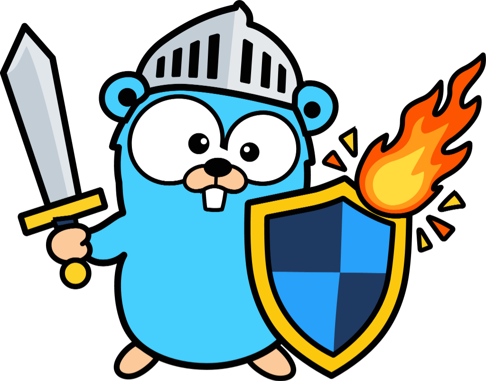
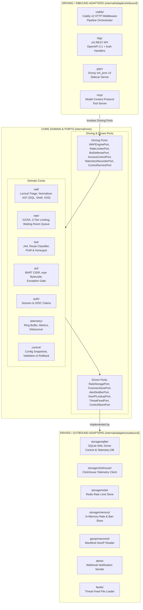

<p align="center">
  
</p>

<h1 align="center">Raiwall</h1>

<p align="center">
  <strong>Enterprise-Grade Web Application Firewall (WAF) & High-Performance Reverse Proxy Gateway</strong>
</p>

<p align="center">
  <a href="https://golang.org"></a>
  <a href="https://caddyserver.com"></a>
  <a href="https://vuejs.org"></a>
  <a href="https://www.typescriptlang.org"></a>
  <a href="#testing"></a>
  <a href="#production-safeguards"></a>
</p>

<p align="center">
  <a href="#overview">Overview</a> •
  <a href="#key-features">Key Features</a> •
  <a href="#architecture">Architecture</a> •
  <a href="#project-structure">Project Structure</a> •
  <a href="#quick-start">Quick Start</a> •
  <a href="#configuration">Configuration</a> •
  <a href="#roadmap">Roadmap</a> •
  <a href="#development">Development</a>
</p>

---

## Overview

**Raiwall** is a self-hosted Web Application Firewall and reverse proxy gateway designed for modern web applications, APIs, and microservices. 

Built natively as a **Caddy v2** module, Raiwall combines extreme proxy throughput with multi-stage semantic threat inspection, stateless bot challenges, anti-CGNAT rate limiting, pluggable storage backends (SQLite, PostgreSQL, ClickHouse, Redis), and real-time forensic visualization — all delivered in a **single, dependency-free binary** embedding a Vue 3 + TypeScript admin dashboard via `go:embed`.

---

## Key Features

### 🛡️ 1. High-Throughput Reverse Proxy & Gateway (Data Plane)
- **Multi-Protocol Gateway:** Native termination and reverse proxying for HTTP/1.1, HTTP/2, HTTP/3 (QUIC), WebSockets, and gRPC.
- **Application Registry & Routing Modes:** Register each application by hostname and route it three ways — reverse proxy to one or more upstreams, static file serving from a document root, or redirect (301/302/307/308) — all resolved by `Host` and hot-swapped on apply without editing the configuration file.
- **Managed TLS Lifecycle:** Per-SNI resolution via `tls.get_certificate.raiwall` across ACME issuance/renewal (CertMagic), uploaded PEM chains, and generated self-signed certificates. Private keys are AES-256-GCM encrypted at rest, and renewal reconciles at startup and after every deploy.
- **Zero-Downtime Hot Swaps:** `atomic.Pointer[ConfigSnapshot]` applies per-site protection states (**Defense**, **Audit**, **Offline**) in nanoseconds without restarting or dropping long-lived connections.
- **Upstream Resilience:** Four selection policies — smooth weighted round-robin, least connections, IP hash, and primary-backup — with background active health probes and automatic failover.
- **Accurate Client Attribution:** Extracts real client IPs through `CF-Connecting-IP`, `X-Real-IP`, `X-Forwarded-For`, and HAProxy `PROXY` protocol v1/v2.

### 🧠 2. Threat Detection Engine & Response DLP (Core WAF)
- **Inbound Three-Stage Funnel:**
  1. *Recursive Normalization:* Multi-pass decoding of URL, HTML entities, Base64, and Unicode escapes with SQL/script comment stripping.
  2. *Pure-Go Lexical Triage:* Ultra-fast token analysis using pure-Go `libinjection-go` ($<2\text{ µs}$) for immediate SQLi/XSS triage with zero CGO overhead.
  3. *Bounded AST Context Verification:* Runs bounded, in-tree context checks to detect execution breakouts (SQL, shell, DOM/JS) without external parser dependencies.
- **Embedded OWASP CRS 4.30 via Coraza:** Native integration of Core Rule Set v4.30 with anomaly scoring (PL1–4), per-application detection policies, and rule exception translation.
- **Outbound Response Inspection & DLP:** Bounded DLP detector scanning response headers and bodies for Payment Card PANs (via Luhn validation, $p99 < 5\text{ ms}$ on 1 MiB), JWT tokens, RSA/EC private keys, AWS access keys (`AKIA`/`ASIA`), and generic secrets. Supports `audit`, `block` (HTTP 403), and `redact` (in-place `[REDACTED]` masking).
- **Paired CRS Response Transactions:** Keeps Coraza transactions alive across the request-response cycle to evaluate outbound leakage rules (e.g. database error disclosures) before release.
- **Response Gate Safeguards:** Hard 8 MiB per-response cap, 64 MiB global in-flight concurrency budget, 25 ms scan timeout deadline, and strict Content-Type gating (`text/*`, `application/xml`, `application/json`, `application/javascript`). Media, SSE streams, and WebSockets pass through directly without RAM buffering.
- **CPU Starvation Defenses:** Hard 32 KB per-parameter caps and strict 5 ms parser timeouts maintain $p99 < 15\text{ ms}$ under heavy load.

### 🤖 3. Bot Mitigation & Dynamic Active Defense
- **Passive Fingerprinting:** Extracts TLS JA4/JA4H hashes and inspects HTTP/2 settings frames to flag headless CLI scrapers (`curl`, `python-requests`, `sqlmap`).
- **Intelligent Route Separation:** API endpoints (`/api/*`, `Authorization: Bearer`, JSON requests) are never subjected to browser challenges, safeguarding native apps and webhooks.
- **Stateless Proof-of-Work (PoW):** Employs WebCrypto SHA-256 challenges returning signed HMAC clearance cookies (`altcha`/`anubis`).
- **SPA Hydration Safe:** Avoids runtime DOM rewriting on modern SPA frameworks (Vue, React, Next.js).

### ⚡ 4. DDoS & Three-Tiered Rate Limiting
- **Tier 1 (Access Velocity):** Traffic surge mitigation at the ingress pipeline; prompts PoW challenges instead of blunt connection drops.
- **Tier 2 (Attack Frequency):** Increments on blocked exploits and automatically bans persistent threat actors.
- **Tier 3 (Scanner Trap):** Hooks into reverse proxy responses; catches upstream 403/404 scans to auto-ban directory brute-forcers (`ffuf`, `gobuster`).
- **Anti-CGNAT Protection:** Composite keys (`ClientIP + JA4 + SessionCookie`) prevent shared IP lockouts across corporate egress or mobile networks.

### 🔑 5. Granular Access Control & False-Positive Tuning
- **Parameter-Level Rule Exceptions:** Suppress specific rules matching Host + Path Regex + Method + exact Parameter Location & Name (e.g., allow markdown in `/posts` body while retaining SQLi protection on other fields).
- **Sub-15ns Expression ACLs:** Evaluates user-defined boolean bytecode rules via `expr-lang/expr`.
- **Sub-Microsecond CIDR Feeds:** Matches 500,000+ threat IPs via Balanced Routing Tables (`gaissmai/bart`) in $\sim 15\text{ ns}$.
- **Zero-Code Pre-Auth:** OIDC / Simple Auth login barrier in front of legacy or staging services.

### 📊 6. Observability, Forensics & Audit Trail
- **Non-Blocking Telemetry:** Async in-memory ring buffer batch-flushed every 500 ms.
- **Dual-Tier Storage:** Embedded SQLite WAL mode by default; batch-ingested ClickHouse for enterprise scale.
- **Tamper-Evident Audit Chain:** Append-only cryptographic audit trail linked with SHA-256 hash chaining, Ed25519 digital signatures every 100 events or 1 hour, and verification API (`/.raiwall/api/v1/audit/verify`).
- **Privacy Compliance:** In-stream automated scrubbing of PII & PCI-DSS 4.0 data (`passwords`, `tokens`, `cvv`) across requests and responses.
- **Visual Attack Map:** 3D threat origin arcs powered by Three.js / `globe.gl` and Apache ECharts.
- **Multi-Channel ChatOps:** Instant push alerts to Telegram, Discord, Slack, and generic webhooks through the built-in HTTP sender.

### 💾 7. Pluggable Storage & Multi-Tier Persistence
- **Decoupled Hexagonal Storage:** Clean separation of data concerns across independent domain ports (`ControlStorePort`, `ForensicStorePort`, `RateStoragePort`) and pluggable outbound adapters.
- **Control Plane Store:** Zero-config embedded **SQLite** (pure Go with WAL mode) for lightweight, single-binary edge deployments, or **PostgreSQL** (`pgx`) for multi-instance HA clusters and shared configuration.
- **Telemetry & Forensics Store:** Embedded **SQLite** for standalone setups or **ClickHouse** for high-ingestion columnar forensic events, automated retention pruning, and historical analytics.
- **Rate Limiting & Ban Store:** In-memory local GCRA token buckets, or **Redis** for distributed multi-gateway cluster synchronization.
- **Automated Schema Migrations:** Built-in schema migrator handles PostgreSQL and SQLite table upgrades transparently at startup.

### 🎛️ 8. Control Plane & Single-Binary Packaging
- **Unified Binary:** REST API (chi router, hand-written OpenAPI 3.1), Embedded Vue 3 Dashboard, and Caddy Data Plane ship in a single compact binary (~50 MB, not strictly bounded under 50 MB).
- **Instant, Versioned Configuration:** Applications, exceptions, ACLs, detector policy, and rate/bot policies are compiled and hot-swapped immediately after each successful save (`control.auto_apply`, enabled in the shipped configuration). Every revision remains rollback-able by version; disable auto-apply to stage changes for a manual deploy.
- **Portable Control Store:** Embedded SQLite in WAL mode by default, or PostgreSQL via `storage.database_url` / `RAIWALL_DATABASE_URL` for multi-instance deployments.
- **Sidecar Mode:** Envoy External Processor (`ext_proc/v3`) gRPC interface for Kubernetes ingress sidecar deployment.

---

## Architecture

Raiwall is architected using **Strict Hexagonal Architecture (Ports and Adapters)**. The application's core domain models, business logic, and security rules are completely decoupled from external frameworks, HTTP transports, and database drivers.

### 1. Hexagonal Ports & Adapters Architecture



### 2. Data Plane Request & Response Inspection Funnel

```mermaid
flowchart TD
    subgraph ControlPlane["CONTROL PLANE (Admin & API)"]
        UI["Vue 3 + radix-vue<br/>(d3)"] <--> API["REST API + OpenAPI 3.1"]
        API <--> DB[("SQLite WAL / PostgreSQL (sqlc)")]
        API --> EngineConfig["Config Validation & Rollback"]
    end

    subgraph DataPlane["DATA PLANE (Caddy v2 + WAF Engine)"]
        Client(["Client Request"]) --> Step1["1. TLS Hook<br/>(CertMagic + JA4 Fingerprint + bart CIDR)"]
        
        Step1 --> Step2{"2. Route Classifier"}
        Step2 -->|"API Route / Bearer Token"| FastPath["API Fast-Path<br/>(Token Validation)"]
        Step2 -->|"Browser Path (HTML)"| Step3["3. Bot Defense<br/>(Altcha / Anubis HTTP 468 PoW)"]
        
        FastPath --> Step4["4. Rate Limiter<br/>(Composite: IP + JA4 + Cookie)"]
        Step3 --> Step4
        
        Step4 --> Step5["5. Exception Gate<br/>(Path / Param False-Positive Bypass)"]
        Step5 --> Step6["6. Custom ACLs<br/>(expr-lang/expr + MaxMind GeoIP)"]
        Step6 --> Step7["7. Stream Filter<br/>(Payloads >1MB Bounded Prefix)"]
        Step7 --> Step8["8. Normalizer<br/>(Coraza: URL / HTML / Base64)"]
        
        Step8 --> Step9{"9. Semantic & CRS WAF"}
        Step9 -->|"Lexical Triage (<2µs)"| LibInj["libinjection-go (Pure Go)"]
        Step9 -->|"Suspicious Tokens"| AST["Bounded Context Verifier<br/>(SQL / shell / DOM-JS checks)"]
        Step9 -->|"CRS Inbound (PL1-4)"| CRSIn["Coraza OWASP CRS"]
        
        LibInj -->|"Verdict: Allow"| Proxy["10. Router<br/>(Proxy / Static / Redirect<br/>+ 4 LB Policies + Scanner Trap)"]
        AST -->|"Verdict: Allow"| Proxy
        CRSIn -->|"Score < Threshold"| Proxy
        AST -->|"Verdict: Block"| Block403(["HTTP 403 Blocked"])
        CRSIn -->|"Score >= Threshold"| Block403
        
        Proxy --> Upstreams[("Protected Backend Services")]
        Upstreams --> Step11{"11. Response Gate<br/>(Content-Type & Size Filter)"}
        Step11 -->|"Binary / SSE / >8MB"| DirectStream(["Direct Client Stream"])
        Step11 -->|"Inspectable (<=8MB)"| DLP["12. Response DLP & Outbound CRS<br/>(PAN Luhn / JWT / Secrets / DB Leaks)"]
        DLP -->|"Verdict: Allow / Redacted"| Resp200(["HTTP 200 to Client"])
        DLP -->|"Verdict: Block"| Resp403(["HTTP 403 Leak Blocked"])
    end

    subgraph Telemetry["TELEMETRY & ALERTING PIPELINE"]
        RingBuffer["Async Ring Buffer<br/>(500ms Batch Flush)"]
        PII["PII / PCI-DSS Sanitizer<br/>(Auto-mask Tokens & Secrets)"]
        Logs[("SQLite WAL / PostgreSQL / ClickHouse")]
        Alerts["Webhook Push Alerts<br/>(Slack, Discord, Telegram)"]
        AuditChain["Tamper-Evident Audit Chain<br/>(Ed25519 Anchors)"]
        
        RingBuffer --> PII
        PII --> Logs
        PII --> Alerts
        Logs --> AuditChain
    end

    EngineConfig -.->|"Hot-Reload (atomic.Pointer)"| DataPlane
    DataPlane -.->|"Forensic Events"| RingBuffer
```



---

## Project Structure

Raiwall enforces **Strict File Modularity**: every handwritten Go file adheres to a strict target of $\le 250$ lines (hard ceiling of 350 lines). Complex pipelines and storage drivers are decomposed into concise, single-responsibility files.

```
raiwall/
├── cmd/
│   └── raiwall/                          # Composition Root (single binary runtime)
│       ├── main.go                       # Caddy runtime entrypoint
│       ├── admin.go                      # Admin CLI bootstrap & user management
│       ├── sidecar.go                    # Envoy ext_proc gRPC sidecar flags
│       ├── mcp.go                        # AI Agent MCP server commands
│       └── version.go                    # Build & version info
├── internal/
│   ├── core/                             # Core Domain & Ports (framework-free)
│   │   ├── waf/                          # Threat detection (lexical triage, AST, normalizer, ports)
│   │   ├── rate/                         # Rate limiting (GCRA, tiers 1-3, waiting room queue, ban)
│   │   ├── bot/                          # Active bot defense (JA4, classifier, PoW, clearance, honeypot)
│   │   ├── acl/                          # Access control (BART CIDR, expr bytecode, exceptions)
│   │   ├── auth/                         # Pre-app authentication (sessions, simple auth, OIDC)
│   │   ├── telemetry/                    # Observability (forensic events, ring buffer, debouncer, metrics)
│   │   └── control/                      # Control plane (snapshot, validator, compiler, rollback)
│   └── adapters/                         # Concrete Technology Adapters
│       ├── inbound/                      # Driving Adapters
│       │   ├── caddy/                    # Caddy v2 HTTP middleware & stage pipeline orchestrator
│       │   ├── http/                     # chi REST API, OpenAPI 3.1 & UI static handler
│       │   ├── grpc/                     # Envoy ext_proc v3 sidecar server
│       │   └── mcp/                      # Model Context Protocol security operations server
│       └── outbound/                     # Driven Adapters
│           ├── storage/                  # SQLite WAL, ClickHouse, Redis, Memory drivers
│           ├── geoip/                    # MaxMind GeoLite2 reader
│           ├── alerts/                   # Multi-channel webhook notification dispatcher
│           └── feeds/                    # Threat intelligence feed loader
├── web/                                  # Vue 3 + TypeScript admin dashboard (embedded via go:embed)
├── tests/
│   └── e2e/                              # End-to-end integration test suites (build tag: integration)
├── config/
│   └── raiwall.yaml                      # Canonical deployable configuration (Compose mount)
├── examples/
│   └── raiwall.yaml                      # Annotated reference covering every schema section
├── deploy/
│   └── helm/raiwall/                     # Helm chart (ConfigMap from values, external PostgreSQL)
├── Dockerfile                            # Multi-stage alpine build (lightweight container, ~50MB)
└── Makefile                              # Build, test, and dev tooling
```

---

## Quick Start

### Prerequisites
- **Go 1.27+**
- `make`

### 1. Build from Source
```bash
git clone https://github.com/Panharoth06/raiwall.git
cd raiwall
make build
```
This produces the standalone binary at `./bin/raiwall`.

### 2. Verify Installation
```bash
./bin/raiwall version
```

### 3. Run with the Shipped Configuration
```bash
make validate-config       # validates config/ and examples/ documents
make run                   # starts the gateway on :8080 / :8443
```

`make run` points SQLite and CertMagic storage at `./data/` so nothing outside
the repository is touched. To run the binary directly:
```bash
RAIWALL_DATABASE_URL="file:./data/raiwall.db?_pragma=busy_timeout(5000)" \
RAIWALL_CERTMAGIC_ROOT="./data/certmagic" \
./bin/raiwall run --config config/raiwall.yaml
```

Or start the full stack (PostgreSQL + demo upstream + gateway) with Docker:
```bash
cp .env.example .env      # then edit secrets
docker compose up -d
```

### 4. Admin CLI & Sidecar Operations
```bash
# Initialize SQLite database and create root admin
./bin/raiwall admin init --db file:raiwall_control.db --username admin --password secret

# Create a viewer user
./bin/raiwall admin create-user --username viewer --role viewer --password secret

# Validate staged configuration changes
./bin/raiwall admin validate --db file:raiwall_control.db

# Apply staged configuration atomically
./bin/raiwall admin apply --db file:raiwall_control.db --description "Deploy v1"

# Rollback configuration to version 1
./bin/raiwall admin rollback --version 1 --db file:raiwall_control.db

# Run standalone Envoy ext_proc gRPC sidecar
./bin/raiwall sidecar --listen :50051 --db file:raiwall_control.db

# Run Model Context Protocol (MCP) server for AI assistants
./bin/raiwall mcp --db file:raiwall_control.db
```

---

## Configuration

Raiwall is configured by a single versioned YAML document, `raiwall.yaml`. The
same document is consumed by the binary, Docker Compose, and the Helm chart —
there is no separate Caddyfile dialect.

### Discovery and precedence

```text
--config <path>
  → $RAIWALL_CONFIG
  → /etc/raiwall/raiwall.yaml
  → ./raiwall.yaml
  → config/raiwall.yaml
  → hard failure with an actionable error
```

Precedence is **built-in defaults < YAML file < curated `RAIWALL_*` environment
variables**. Environment overrides exist only for deployment-specific values
(listeners, DSNs, bootstrap admin, HMAC/PoW/session secrets, sidecar address,
log level); everything else is file-driven.

Validate any document before deploying:

```bash
./bin/raiwall config validate --config config/raiwall.yaml
./bin/raiwall config print --config config/raiwall.yaml   # adapted Caddy JSON
```

### Example (`raiwall.yaml`)

```yaml
# raiwall.yaml
version: 1

server:
  http:  { enabled: true, listen: ":8080" }
  https: { enabled: true, listen: ":8443", http3: true, tls_min_version: "1.2" }
  auto_https: false

storage:
  database_url: "${RAIWALL_DATABASE_URL:-file:/var/lib/raiwall/raiwall.db?_pragma=busy_timeout(5000)}"

control:
  hmac_secret: "${RAIWALL_HMAC_SECRET:-}"
  bootstrap_admin:
    username: admin
    password: "${RAIWALL_ADMIN_PASSWORD:-}"   # empty = generated once at startup
    role: admin

waf:
  mode: defense
  ast_timeout: 5ms
  max_param_size: 32768

applications:
  - name: portal
    hostnames: ["portal.example.com"]
    mode: defense
    routing_type: proxy
    upstreams:
      - dial: "10.0.0.10:8080"
        weight: 3
      - dial: "10.0.0.11:8080"
        weight: 1

ip_groups:
  - name: private_networks
    entries:
      - cidr: 10.0.0.0/8
      - cidr: 192.168.0.0/16

acls:
  - name: block_admin_from_public
    expression: "has_prefix(path, '/admin') && !in_ip_group(client_ip, 'private_networks')"
    action: block
```

The complete annotated reference is [`examples/raiwall.yaml`](examples/raiwall.yaml);
every key, default, and constraint is documented in
[`docs/configuration.md`](docs/configuration.md).

### Schema sections

| Section | Purpose |
| :--- | :--- |
| `server` | HTTP/HTTPS listeners, HTTP/3, TLS minimum, automatic HTTPS, ACME |
| `caddy` | Caddy admin endpoint and certificate storage backend |
| `logging` | Level (`debug`/`info`/`warn`/`error`), format (`json`/`console`), output |
| `storage` | Pluggable `database_url` or named `stores` (`sqlite`, `postgres`, `clickhouse`) bound to `control` and `telemetry` roles |
| `control` | Admin HMAC secret and bootstrap operator |
| `security` | `strict_secrets` rejects inline plaintext secrets |
| `waf` | Run mode, block/offline responses, AST timeout, parameter cap, stripped headers |
| `bot` | Bot defense mode, PoW difficulty/secret, clearance TTL, honeypot |
| `rate_limit` | Three tiers (velocity, attack frequency, scanner trap) and memory/Redis storage |
| `waiting_room` | Bounded admission queue and target paths |
| `auth` | Portal-wide zero-trust gate (simple users or OIDC) |
| `telemetry` | Flush interval, buffer, retention, alert channels (Slack/Discord/Telegram/webhook) |
| `sidecar` | Envoy `ext_proc` gRPC listener |
| `geoip` / `threat_feeds` | MaxMind databases and local CIDR feeds |
| `declarative` | `off` / `seed` / `sync`, `prune`, `strict` |
| `applications`, `certificates`, `acls`, `exceptions`, `ip_groups`, `rate_policies`, `bot_policies`, `identity_providers`, `templates`, `detector` | File-declared resources |

### Secrets

Use `${VAR}` placeholders; the loader also resolves `VAR_FILE` (Docker/Kubernetes
secret file mounts) and `${VAR:?message}` for required values. Inline plaintext
secrets are accepted with a startup warning, or rejected outright when
`security.strict_secrets: true`.

When `control.bootstrap_admin.password` is empty, Raiwall generates a random
password on first start and logs it once at WARN level.

### Declarative resources & UI overrides

File-declared resources receive deterministic IDs (`cfg:<kind>:<name>`), so the
file and the database stay predictable:

- `mode: seed` creates missing records only; UI edits are preserved.
- `mode: sync` upserts declared records.
- `prune: true` deletes file-managed records that are no longer declared.
- `strict: true` aborts startup on conflicts with API-managed records; otherwise
  conflicting resources are skipped with a warning.

Records declared by the file are marked `managed: true` in the API. When edited
or deleted through the web UI or REST API, Raiwall automatically records an
ownership override (`declarative_overrides`). This allows dashboard adjustments
to coexist seamlessly with `raiwall.yaml` without 409 Conflict errors or
unexpected rollbacks on the next declarative sync. A new snapshot is deployed
only when the compiled content hash changes, so restarting with an unchanged file
does not churn config versions.

### Pluggable Storage

Raiwall features a pluggable, multi-tier storage architecture that decouples control plane state, forensic telemetry logs, and rate limit counters into dedicated, role-bound stores:

| Store Role | Supported Drivers | Description | Recommended Deployment |
| :--- | :--- | :--- | :--- |
| **Control Plane** (`control`) | `sqlite`, `postgres` | Applications, certificates, ACLs, exception rules, IP groups, policies, and users | Embedded SQLite for single-binary / edge; PostgreSQL for multi-gateway HA clusters |
| **Telemetry & Forensics** (`telemetry`) | `sqlite`, `clickhouse` | High-frequency security event logs, audit records, and incident rollups | Embedded SQLite for standard traffic; ClickHouse for large-scale analytics & long retention |
| **Rate Limiter & Bans** (`rate_limit`) | `memory`, `redis` | GCRA token buckets, sliding windows, and active IP bans | In-memory local storage for zero-latency caching; Redis for cluster-wide synchronized bans |

#### 1. Single Database Shortcut (`storage.database_url`)

For lightweight or single-node deployments, `storage.database_url` (or the `RAIWALL_DATABASE_URL` environment variable) binds both the `control` and `telemetry` roles to a single database. The driver is automatically detected from the DSN (`postgres://` for PostgreSQL, otherwise SQLite):

```yaml
storage:
  database_url: "${RAIWALL_DATABASE_URL:-file:/var/lib/raiwall/raiwall.db?_pragma=busy_timeout(5000)}"
```

#### 2. Split-Role Architecture (`storage.stores`)

For production and enterprise setups, declare named stores with custom connection pooling, retention limits, and independent backends:

```yaml
storage:
  stores:
    control:
      driver: postgres
      dsn: "${RAIWALL_CONTROL_DSN:?control DSN required}"
      max_open: 20
      max_idle: 10
    telemetry:
      driver: clickhouse
      dsn: "${RAIWALL_TELEMETRY_DSN:?telemetry DSN required}"
      retention: 720h       # 30-day retention with automatic background pruning
      prune_interval: 1h
  control: control
  telemetry: telemetry

rate_limit:
  storage: redis           # memory (local) or redis (cluster-wide sync)
  storage_addr: "redis:6379"
  storage_password: "${REDIS_PASSWORD:-}"
```

The bundled Docker Compose stack configures PostgreSQL via `RAIWALL_DATABASE_URL`, while the Helm chart connects to an external PostgreSQL instance. Automated schema migrations run transparently at startup for both SQLite and PostgreSQL.

### Applications, Routing & Certificates

Applications can be declared in `applications:` or registered through
**Protected Sites** (`/.raiwall/#/sites`). Each application declares:

| Field | Options |
| :--- | :--- |
| **Hostnames** | Exact names or wildcards (`*.example.com`); `*` matches any host |
| **Routing** | `proxy` (one or more upstreams), `static` (absolute document root), `redirect` (absolute URL or site-relative path) |
| **Load balancing** | `round_robin` (smooth weighted), `least_conn`, `ip_hash`, `primary_backup` |
| **TLS mode** | `none`, `auto`, `manual` |

- **`none`** — plain HTTP only; any HTTPS listener on the site is rejected.
- **`auto`** — public DNS names are issued through ACME; internal or private hostnames get a generated self-signed certificate.
- **`manual`** — requires a managed certificate (referenced by name in YAML) whose SANs cover every hostname of the site.

Certificates live under **Settings → TLS Certificates** or in the
`certificates:` list, and come from three sources: generated self-signed,
uploaded PEM chain + key (validated to match), or ACME. Keys are AES-256-GCM
encrypted before storage and never returned by the API. Deletion is refused
with **409** while a site references the certificate or serves a covered
hostname.

### Deployment

- **Docker Compose:** `config/raiwall.yaml` is mounted read-only at
  `/etc/raiwall/raiwall.yaml`; secrets come from `.env` (see `.env.example`).
- **Applying changes:** `control.auto_apply: true` commits every successful
  control-plane mutation to a new snapshot immediately. Set it to `false` to
  stage changes and deploy them from **Deployments & Rollback History**.
- **Helm:** `deploy/helm/raiwall/values.yaml#config` mirrors the schema 1:1 and
  renders a ConfigMap. Secrets are injected from a chart-managed Secret or an
  existing Secret. See [`deploy/helm/raiwall/README.md`](deploy/helm/raiwall/README.md).

### Run Modes
- **`defense`**: Full threat detection active. Malicious requests are blocked immediately with an HTTP 403 response.
- **`audit`**: Passive inspection. Attacks are detected, logged, and audited without blocking client traffic.
- **`offline`**: Maintenance state. Serves a clean HTTP 503 maintenance page immediately without burdening backends.

### Accessing the Control Plane & Documentation
- **Web Admin Dashboard:** `http://localhost:8080/.raiwall/`
- **Applications & Routing:** `http://localhost:8080/.raiwall/#/sites`
- **Managed Certificates:** `http://localhost:8080/.raiwall/#/settings`
- **Interactive OpenAPI 3.1 Scalar Docs:** `http://localhost:8080/.raiwall/api/docs`
- **OpenAPI 3.1 JSON Specification:** `http://localhost:8080/.raiwall/api/openapi.json`
- **Model Context Protocol (MCP) SSE Stream:** `http://localhost:8080/.raiwall/api/mcp`

A host that has **no site configured** has nothing to proxy, so browser navigations to
it (`Accept: text/html`, `GET`/`HEAD`) are answered with `302 Found` →
`/.raiwall/`. Opening `http://localhost:8080/` on a fresh install therefore lands on
the dashboard instead of the bot challenge. API clients, probes and non-GET methods
are never redirected. The redirect is `Cache-Control: no-store`, so it disappears the
moment a site claims that hostname.

---

## Development

### Makefile Targets

```bash
make build              # Compile single binary ./bin/raiwall (with embedded UI)
make test               # Run unit tests
make test-race          # Run unit tests with Go race detector
make test-integration   # Run end-to-end integration test suite
make test-all           # Run all unit and integration tests with -race
make lint               # Run go vet
make run                # Run Raiwall with config/raiwall.yaml
make web-dev            # Run Vue 3 admin dashboard in Vite dev mode
make web-build          # Build production Vue 3 admin dashboard into web/dist
make web-test           # Run Vue 3 frontend test suite with Vitest
```

### Testing

All packages are tested with the Go race detector enabled:
```bash
go test -v -race -tags=integration ./...
```

Frontend unit tests with Vitest:
```bash
cd web && pnpm test
```

---

## Production Safeguards

| Concern | Constraint / Risk | Mitigation Strategy |
| :--- | :--- | :--- |
| **AST ReDoS** | Heavy regex/nesting causing CPU starvation | Hard 32 KB per-parameter cap + 5 ms parser timeout fallback |
| **OOM Panics** | Large uploads (100 MB+) filling memory | Payloads $>1\text{ MB}$ stream directly to upstream; only form fields inspected |
| **GC Pauses** | Latency spikes under $>50\text{K}$ QPS | Zero-allocation `sync.Pool` byte-buffer pooling on hot path |
| **API Disruption**| B2B clients crashing on bot challenges | Route classifier exempts `/api/*`, bearer tokens, and JSON requests |
| **CGNAT Ban** | Banning an entire campus on bad client IP | Composite rate-limiting keys: `ClientIP + JA4 + SessionCookie` |
| **SPA Errors** | DOM manipulation breaking client hydration | Strict non-rewriting of HTML for modern SPA/SSR frameworks |
| **DLP Latency** | Regex over 1 MiB bodies causing CPU spikes | 25 ms hard timeout deadline per scan; zero-allocation word-boundary candidate tokenization (`scanPAN`) evaluating only 13–30 digit runs; $p99 < 5\text{ ms}$ on 1 MiB |
| **Response OOM**| Buffering high-throughput responses | Buffer only inspectable Content-Types (`text/*`, `application/xml`, `application/json`, `application/javascript`); 8 MiB hard cap; 64 MiB global in-flight concurrency budget; media, SSE, and WebSockets bypass buffering |

---

## Tech Stack

- **Data Plane:** Go 1.27+, Caddy v2 (`caddyhttp`), CertMagic, `libinjection-go`, Coraza (OWASP CRS), `exaring/ja4plus`, `gaissmai/bart`, in-tree bounded context checks.
- **Control Plane:** chi router + hand-written OpenAPI 3.1, `sqlc`, SQLite (`modernc.org/sqlite`), PostgreSQL (`pgx`), Zap logging, Prometheus metrics, built-in webhook alerting (Slack/Discord/Telegram), Model Context Protocol (MCP).
- **Dashboard UI:** Vue 3, TypeScript, Vite, `radix-vue` primitives in a shadcn-style component library, Tailwind CSS, Pinia, custom router, d3 visualizations.

---

## Roadmap & Current Status

The authoritative capability matrix, architecture decisions, and phased plan live in **[ROADMAP.md](ROADMAP.md)**. The working checklist with acceptance criteria and commit references lives in **[TASKS.md](TASKS.md)**.

### 🟢 Current Features (Implemented & Verified)

- **Reverse Proxy & Gateway (Data Plane):** Multi-protocol termination (HTTP/1.1, HTTP/2, HTTP/3/QUIC, WebSockets, gRPC), smooth weighted round-robin / least-connections / IP-hash / primary-backup load balancing, active health checks, CertMagic automated ACME & managed certificates with AES-256-GCM encrypted keys at rest, accurate client IP extraction (`trusted_proxies`, PROXY protocol v1/v2).
- **Inbound Threat Detection Core:** Three-stage semantic funnel (recursive normalization → `libinjection-go` triage $< 2\text{ µs}$ → bounded AST execution breakout verifiers for SQL/shell/XSS), composed with embedded **OWASP CRS 4.30 via Coraza** (PL1–4 anomaly scoring, per-app policies, rule exception $\to$ CRS exclusion translation, and `/rules/test` interactive playground).
- **Outbound Response Inspection & Bounded DLP (Wave 1):** Scans response headers and bodies for Payment Card PANs (via Luhn validation, $p99 < 5\text{ ms}$ on 1 MiB), JWTs, RSA/EC private keys, AWS access keys (`AKIA`/`ASIA`), and generic secrets with `audit`, `block` (HTTP 403), and `redact` (`[REDACTED]` masking). Includes paired CRS response transactions, Content-Type gating (`text/*`, `application/xml`, `application/json`, `application/javascript`), 8 MiB hard cap, 64 MiB global in-flight concurrency budget, and 25 ms scan deadline.
- **Active Bot Defense & Dynamic Rate Limiting:** Passive TLS JA4/JA4H fingerprinting, HTTP/2 settings frame inspection, route classification (API fast-path bypassing bot checks), WebCrypto SHA-256 Proof-of-Work (`altcha`/`anubis` HTTP 468), and 3-tiered composite rate limiting (`ClientIP + JA4 + Cookie`) with anti-CGNAT protection.
- **Granular Access Control:** Parameter-level false-positive exceptions, sub-15ns boolean bytecode ACLs (`expr-lang/expr`), dynamic BART routing table CIDR matching ($\sim 15\text{ ns}$ across 500K+ IPs), MaxMind GeoIP, and zero-code pre-application authentication.
- **Observability & Cryptographic Audit Trail:** Non-blocking async ring buffer (500 ms flush), dual-tier storage (SQLite WAL / ClickHouse), PII/PCI-DSS automated masking, 3D WebGL attack globe, multi-channel alerting (Slack, Discord, Telegram, webhooks), and an append-only audit log with SHA-256 hash chaining, Ed25519 digital signatures, and live verification (`/.raiwall/api/v1/audit/verify`).
- **Control Plane & High Availability:** Unified single-binary distribution with embedded Vue 3 dashboard (`go:embed`), atomic zero-downtime hot-swap configuration via `atomic.Pointer[ConfigSnapshot]`, declarative YAML configuration (`raiwall.yaml`), multi-replica Redis ban hydration and config notification fan-out, and Envoy `ext_proc/v3` gRPC sidecar mode.
- **Performance & Stress Verification:** 500 RPS sustained benign on/off stress gate with $p99 \le 1.0\text{ ms}$ overhead ($\le 2\text{ ms}$ ceiling) and stable RSS ($< 5\text{ MB}$ delta); 1 MiB DLP scan $p99 = 4.87\text{ ms}$ ($\le 25\text{ ms}$ ceiling); 100 concurrent 1 MiB responses with zero OOMs.

---

### 🚀 Next Future Plan (Phased Roadmap)

| Phase & Feature | Scope & Key Deliverables | Priority |
| :--- | :--- | :--- |
| **1B.2 Normalization Depth** | Base64 and hex decoding pipelines, JSON-in-JSON recursive extraction, configurable body-prefix inspection policy, encoded SQLi/XSS evasion corpus. | **P1 (Immediate Next)** |
| **1B.3 Content Parsers & Schemas** | XML parser with XXE protection & entity caps, GraphQL depth/complexity/alias limits, per-site OpenAPI 3.0/3.1 request schema validation. | P1 |
| **1B.4 Uploads & Malware Scanning** | Multipart file magic-byte validation, polyglot upload detection (GIF/PHP, PNG/JS), antivirus hook for ClamAV / ICAP daemons. | P1 |
| **1B.5 Protocol & Transport Security**| Request smuggling mitigations on raw frontends, full WebSocket/gRPC streaming upstream proxying with trailers and h2c, client mTLS per site. | P1 |
| **1B.6 Detection Operations** | Per-host rate/bot policies, expansion of CVE virtual patches from 87 to 193 rules, threat intelligence IP feeds and JA4 reputation lists. | P1 |
| **Phase 2: Observability & SIEM** | OpenTelemetry distributed tracing (WAF phases, upstream, response), Enterprise SIEM pipeline (RFC 5424, CEF, LEEF, Splunk HEC, Sentinel DCR, Elastic), WORM compliance storage (S3 Object Lock), automated PCI-DSS/SOC2 compliance reports. | P2 |
| **Phase 3: Identity & Multi-Tenancy** | Operator OIDC SSO with PKCE + TOTP 2FA, granular 5-role RBAC matrix & scoped API keys, secrets keyring with external KMS (Vault/AWS/GCP), `tenant_id` row-level isolation. | P1 / P2 |
| **Phase 4: Clustering & Kubernetes** | Production `go-redis/v9` driver with Sentinel/Cluster, distributed apply locks & leader election, shared TLS storage, distributed waiting room, production Helm HA chart with PDB/HPA. | P0 / P1 |
| **Phase 5: Supply Chain & Distribution** | GitHub Actions CI/CD workflows, Syft SBOM & Cosign container signing, air-gapped deployment bundle (offline fonts, GeoIP, and CRS rules), official Apache-2.0 license. | P0 / P1 |

> [!NOTE]
> Historical SafeLine-parity notes under `tasks/` are no longer authoritative. Please refer to [`ROADMAP.md`](ROADMAP.md) and [`TASKS.md`](TASKS.md).

---

## License

License terms are not finalized. No license is granted for redistribution until a LICENSE file is added; contact the maintainers first.
