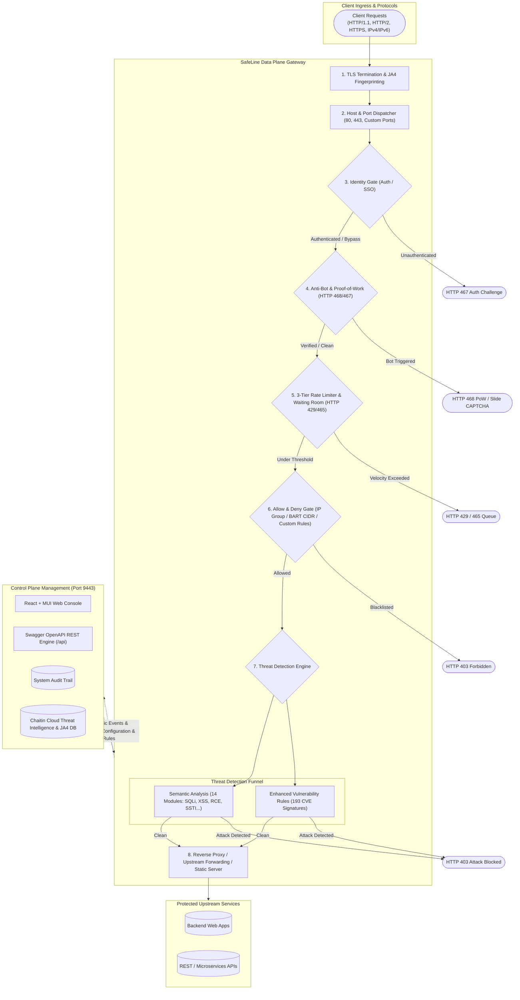

# Chaitin SafeLine WAF — Complete User Flow & Architecture Research

> **Target Under Analysis:** Chaitin SafeLine WAF (雷池) Web Console v9.4.2  
> **Demo Environment:** `https://demo.waf.chaitin.com:9443/statistics`  
> **Research Date:** October 2026  
> **Analyst:** Antigravity AI Engine

---

## Executive Summary

Chaitin SafeLine (雷池) is an enterprise and community Web Application Firewall (WAF) developed by Chaitin Technology (CTStack / 长亭科技). The demo deployment at `https://demo.waf.chaitin.com:9443/` represents Version **9.4.2 Pro**, showcasing an end-to-end WAF gateway, semantic threat detection engine, active anti-bot challenge infrastructure, three-tier DDoS defense, pre-application zero-trust identity authentication, and distributed cluster operations.

This research documentation suite provides a complete, exhaustive reverse-engineering of the user flow, UI/UX architecture, security engine capabilities, and underlying REST API contract.



---

## Documentation Structure

This repository includes a multi-part breakdown of the complete SafeLine system:

| Document | Focus & Scope |
| :--- | :--- |
| **[user-flow-map.md](./user-flow-map.md)** | Detailed state machines, navigation maps, modal workflows, page-to-page user transitions, and persona scenarios. |
| **[module-deep-dive.md](./module-deep-dive.md)** | Exhaustive breakdown of all 8 core modules: UI fields, controls, parameters, and algorithms. |
| **[api-specification.md](./api-specification.md)** | Full REST API catalog extracted from Swagger schema (`/swagger/doc.json`), grouped by domain. |
| **[comparative-analysis-raiwall.md](./comparative-analysis-raiwall.md)** | Strategic architectural comparison between SafeLine WAF and **Raiwall** (Caddy v2 + Go + Vue 3). |

---

## Global Navigation Structure & Route Catalog

The SafeLine Web Console employs a persistent left navigation drawer accompanied by a top status banner:

```
SafeLine WAF (v9.4.2 Pro)
├── 1. Statistics (/statistics)
│   ├── Tab: Traffic Analysis (/statistics)
│   └── Tab: Security Posture (/statistics/security)
│
├── 2. Applications (/sites)
│   ├── Application Inventory Cards & Filters (/sites)
│   ├── Add Application Modal (Multi-port, SSL, Proxy/Static/Redirect)
│   └── Application Detail (/sites/detail?id=:id)
│       ├── Tab: Basic Information (&tab=basicInfo)
│       ├── Tab: Forwarding Rules (&tab=forwardingRule)
│       ├── Tab: Advanced Settings (&tab=proxyConfig)
│       └── Tab: Routings / API Inventory (&tab=resource)
│
├── 3. Attacks (/attact_events)
│   ├── Tab: Aggregated Events (/attact_events?tab=event)
│   ├── Tab: Granular Attack Logs (/attact_events?tab=log)
│   ├── Forensic Event Inspector Drawer (Raw Request/Response, JA4, cURL)
│   ├── Sub-View: Semantic Analysis Matrix (/attact_events/semantics)
│   └── Sub-View: Enhanced CVE Rules (/attact_events/inner_rules)
│
├── 4. Allow & Deny (/allow_deny_events)
│   ├── Tab: Hit Events Log (/allow_deny_events)
│   └── Sub-View: Custom Rules Engine (/allow_deny_events/custom_rule)
│       ├── Tab: Whitelist
│       ├── Tab: Blacklist
│       └── Multi-Condition Rule Builder Modal
│
├── 5. HTTP Flood (/http_flood)
│   ├── View: Rate Limiting Active Blocklist (/http_flood/limits)
│   ├── View: 3-Tier Rate Limiting Configuration (/http_flood/limits/config)
│   │   ├── Tier 1: Basic Access Limit (Velocity -> Anti-Bot Challenge)
│   │   ├── Tier 2: Basic Attack Limit (Attack Frequency -> Auto-Ban)
│   │   ├── Tier 3: Basic Error Limit (Scanner Trap 403/404 -> Auto-Ban)
│   │   └── Custom Rate Limit Rule Builder Modal
│   └── View: Waiting Room Throttling & Telemetry (/http_flood/waiting_room)
│
├── 6. Anti-Bot (/captcha)
│   ├── Active Bot Challenges Table (/captcha)
│   └── Challenge Configuration Modal (Cloud Challenge vs. Local Challenge)
│
├── 7. Auth (/auth)
│   ├── Authentication Event Logs Table (/auth)
│   └── Sub-View: Identity Configuration (/auth/config)
│       ├── Tab: User Management (5000 users directory, 2FA, App assignments)
│       ├── Tab: Single Sign-On / SSO Gateway (&cusTabVal=unified)
│       └── Tab: Login Configuration (&cusTabVal=config: Local, GitHub, OIDC, LDAP)
│
└── 8. Settings (/system)
    ├── Tab: Protections (/system?tab=rules)
    │   ├── IP Group Management (CIDR, Search Spiders, Threat Intel)
    │   ├── JA4 TLS Fingerprint Database
    │   ├── SSL/TLS Certificates Repository
    │   ├── Custom HTTP Status Code & Blocking Pages (403, 404, 429, 465, 467, 468, 502, 504)
    │   ├── Engine Performance Mode (Single vs Multi-thread)
    │   ├── Data Retention & Auto-Pruning
    │   ├── High Availability / Master-Slave Node Sync
    │   ├── Push Notifications (Telegram, Discord, Webhooks)
    │   ├── Remote Syslog / SIEM Forwarding
    │   └── Community Threat Intelligence Sharing Program
    ├── Tab: Management (/system?tab=console)
    │   ├── Administrator User Accounts & 2FA
    │   ├── OpenAPI Tokens Generator & Embedded Swagger Documentation
    │   ├── Web Console SSL Binding (Port 9443)
    │   ├── Global Outbound Proxy Settings
    │   └── System Hardware / License Info
    └── Tab: System Log (/system?tab=logs)
        └── Immutable Administrative Audit Trail
```

---

## Key Highlights & Innovations Identified

1. **Semantic Matrix vs. Traditional Signatures**: Rather than relying purely on regex pattern matching, SafeLine exposes 14 semantic modules (SQLi, XSS, Command Injection, Deserialization, SSTI, etc.) with 4 policy modes (*Disabled, Audit, Balance, Strict*), supplemented by 193 high-value CVE virtual patch rules.
2. **Deterministic Custom Status Codes**:
   - `HTTP 403`: Attack Blocked
   - `HTTP 429`: Rate Limit Exceeded
   - `HTTP 465`: Waiting Room Virtual Queue
   - `HTTP 466`: Upstream Application Offline
   - `HTTP 467`: Pre-Application Identity Auth Challenge
   - `HTTP 468`: Anti-Bot Proof-of-Work Challenge
3. **JA4 TLS Fingerprinting**: Full support for passive client fingerprinting directly integrated into forensic attack logs, IP intelligence, and bot defense policies.
4. **Local vs. Cloud Challenge Flexibility**: Operators can toggle between high-capability managed Cloud Verification or zero-telemetry, air-gapped Local Challenge execution.
5. **Integrated Waiting Room**: Enterprise traffic queuing system protecting backend databases during flash traffic without crashing upstreams.
6. **API Resource Auto-Discovery**: Automatic cataloging of upstream REST endpoints, HTTP methods, and content types observed in transit.
