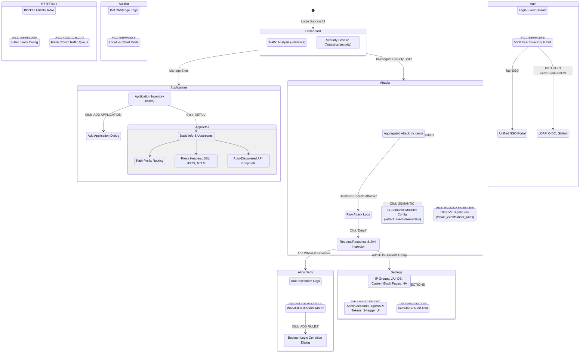
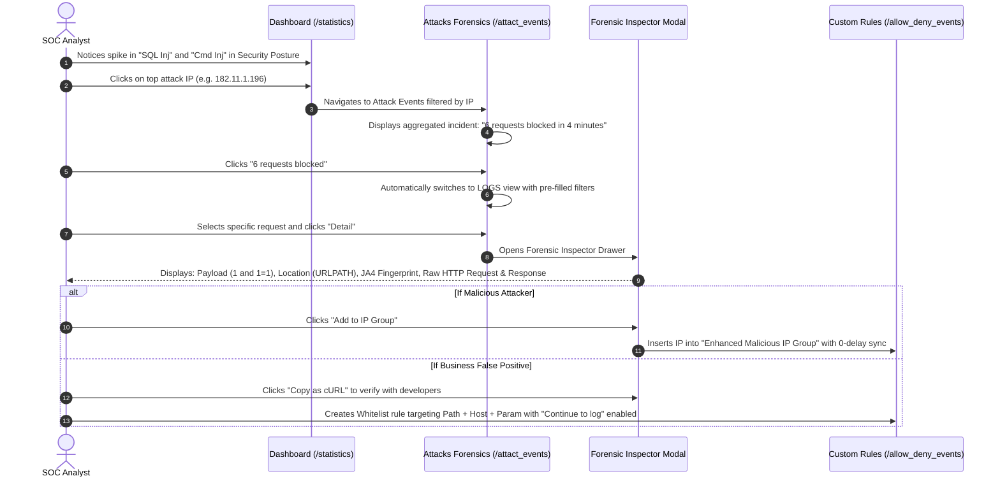
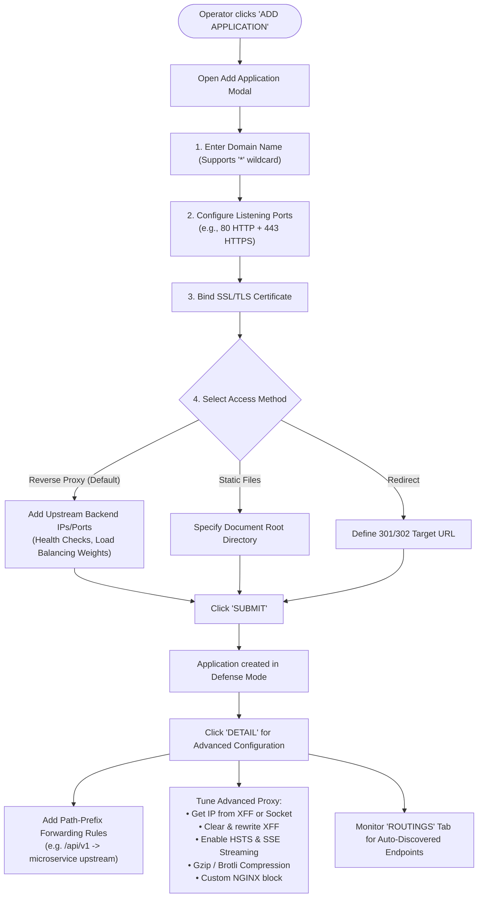
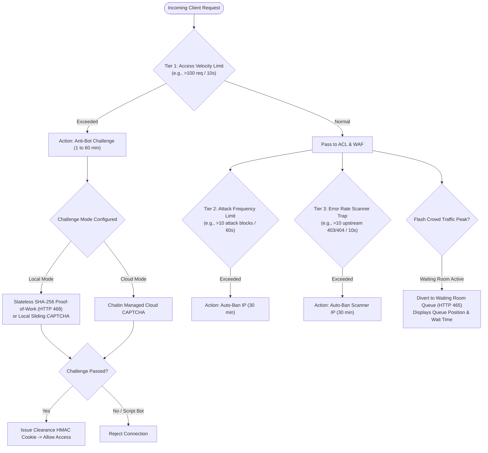
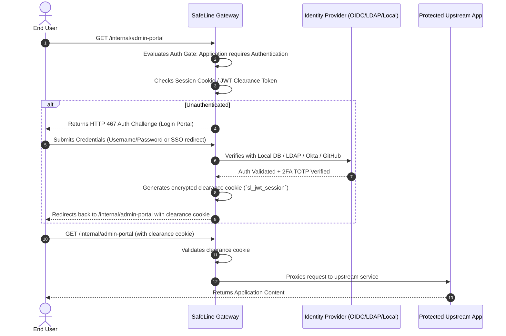
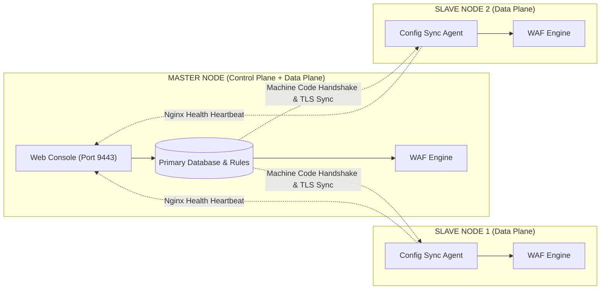

# SafeLine WAF — User Flow & Journey Maps

This document maps out the operator workflows, interactive state transitions, navigation paths, and user journeys within Chaitin SafeLine WAF v9.4.2.

---

## 1. Core Operator Personas & Objectives

| Persona | Primary Modules Used | Typical Objectives |
| :--- | :--- | :--- |
| **SOC Security Analyst** | Attacks, Statistics, Allow & Deny | Monitor real-time attack events, inspect payloads, identify zero-day or exploit attempts, triage false positives, and whitelist safe endpoints. |
| **DevOps / Gateway Engineer** | Applications, Settings, HTTP Flood | Onboard new upstream domains, bind multi-port listeners, configure SSL/TLS certificates, setup path-prefix routing, tune upstream proxy headers, and establish HA clusters. |
| **Infrastructure / SRE** | HTTP Flood, Waiting Room, Anti-Bot | Mitigate Layer 7 volumetric floods, activate the Waiting Room during traffic peaks, configure IP velocity rate limits, and select local vs. cloud bot challenges. |
| **IAM / Security Architect** | Auth, Settings | Enforce zero-trust access control before upstream applications, integrate enterprise SSO (OIDC/LDAP), issue API tokens, and audit admin change logs. |

---

## 2. Interactive Navigation State Machine

---

## 3. Step-by-Step Operator User Flows

### Flow A: Attack Investigation & Remediation Flow

**Key Interactions in Flow A:**
1. **Context Preservation**: Clicking an attack incident in the `EVENTS` tab auto-populates the query parameters in the `LOGS` tab (`ip`, `host`, `port`, `action`, `start`, `end`), preventing manual entry.
2. **Forensic Integrity**: The drawer allows inspecting the exact payload extracted by the AST/lexical engine (`URLPATH: 1 and 1=1`), the client JA4 TLS hash, and offers one-click **"Copy as cURL"** for offline reproduction.
3. **In-place Remediation**: Direct action buttons inside the drawer allow blacklisting the source IP or whitelisting the transaction.

---

### Flow B: Onboarding a New Application / API Gateway

---

### Flow C: Three-Tier DDoS & Anti-Bot Defense Flow

SafeLine coordinates volumetric defense across three cascading tiers before triggering full IP bans:

---

### Flow D: Pre-Application Zero-Trust Identity Authentication Flow

SafeLine features an integrated identity verification gateway (*Auth Challenge*), intercepting unauthenticated traffic before it touches upstream applications:

---

### Flow E: Cluster Operations & High Availability (Master-Slave Sync)

SafeLine supports enterprise multi-node deployment with automated synchronization:

1. **Slave Registration**: Operator inputs Slave Machine Code and IP Address in `Settings -> Protections -> Config Auto Sync`.
2. **Version Pinning**: SafeLine verifies that all nodes share identical version numbers (e.g., `9.4.2`) and compatible license tiers.
3. **Hot Configuration Push**: Changes made on Master (sites, semantic thresholds, IP groups, rate limits) sync across all slaves in sub-second latency.
4. **Health Heartbeat**: Master dashboard continuously displays node sync status (`Normal`, `Synchronizing`, `Offline`).
