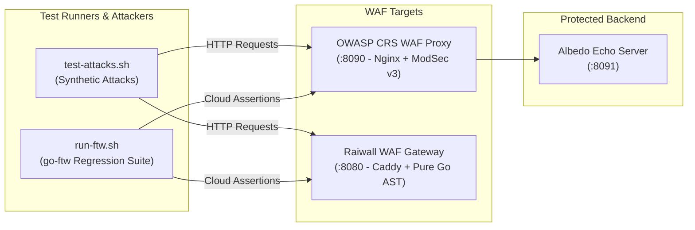

# WAF Testing Lab (OWASP CRS & Automated Attack Suite)

This test lab provides an isolated environment to test and benchmark Web Application Firewalls (such as OWASP CRS and Raiwall) against real-world attack vectors and official OWASP regression test suites.

---

## Architecture



---

## Components

| Component | Port | Description |
|-----------|------|-------------|
| **`crs-waf`** | `http://localhost:8090` | Official OWASP ModSecurity CRS reference proxy (running CRS v4 in blocking mode with Paranoia Level 1). |
| **`crs-backend`** | `http://localhost:8091` | Albedo reflection/echo server used as the upstream target. |
| **`test-attacks.sh`** | CLI | Interactive shell script testing SQLi, XSS, RCE, Path Traversal, Scanners, and Benign requests. |
| **`run-ftw.sh`** | CLI | Official OWASP `go-ftw` runner running tests directly from `coreruleset/tests/regression/tests/`. |

---

## Quickstart

### 1. Start the CRS Test Container
```bash
docker compose -f test-lab/docker-compose.yml up -d
```

### 2. Run Synthetic Attacks & Benchmark
Run the built-in attack script against both CRS and Raiwall:
```bash
./test-lab/test-attacks.sh
```
Target only the CRS reference container:
```bash
./test-lab/test-attacks.sh --target crs
```

### 3. Run Official OWASP CRS Regression Tests (`go-ftw`)
Test SQL Injection rule families:
```bash
./test-lab/run-ftw.sh --rule 942
```
Test XSS rule families:
```bash
./test-lab/run-ftw.sh --rule 941
```
Test RCE rule families:
```bash
./test-lab/run-ftw.sh --rule 932
```
Run tests against Raiwall:
```bash
./test-lab/run-ftw.sh --target raiwall --rule 942100
```

### 4. Inspect Live ModSecurity Logs & Anomaly Scores
```bash
tail -f test-lab/logs/error.log
```

---

## Stopping the Lab
```bash
docker compose -f test-lab/docker-compose.yml down
```
